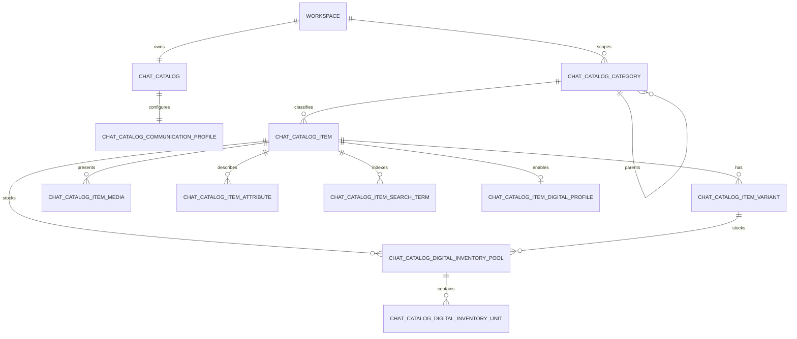

# Chat Catalog v2 architecture

## Scope

Chat Catalog is a workspace-scoped Commerce/Conversation catalog. It is deliberately
independent of Finance Product, POS Menu Item, checkout, orders, payments, and
fulfillment. A catalog has one root configuration record per workspace, categories,
items, variants, public media, structured attributes, and (for digital products)
private inventory pools and units.

All customer discovery is read-only. This phase does not create carts, orders,
payments, bookings, public download links, customer credential delivery, or any
external Meta/marketplace catalog synchronization.

## Invariants

- Every tenant-owned model extends `WorkspaceScopedModel`. Public discovery explicitly
  establishes `WorkspaceContext` after resolving the public workspace slug.
- Seller identifiers are checked against the catalog workspace in
  `ChatCatalogRootService` and `ChatCatalogService`; they are never accepted from AI.
- Prices use HASEM's `App\Support\Money\Money`. No catalog service performs
  floating-point money arithmetic.
- Search reads only Chat Catalog models. It does not query Finance or POS models.
- Customer and AI search never joins digital units, and digital secrets/private paths
  are absent from API resources, prompt rows, audit payloads, and exception messages.
- Catalog text, communication preferences, templates, and AI-safe profiles are
  untrusted business data. They are not authorization, tool, or system instructions.

## Runtime flow

1. `ChatCatalogRootService::forWorkspace()` lazily provisions the root and the
   communication profile. A workspace with legacy v1 items starts as published so
   existing customer search is not silently broken.
2. `CatalogAvailabilityService` decides whether the catalog is open. A published
   catalog remains discoverable while temporarily closed so public Chat can show its
   configured closed message; its item availability is forced to unavailable.
3. `ChatCatalogRetrievalService` applies catalog status, channel, discovery, item,
   category, variant, publication, availability, and display rules before returning
   customer-safe rows. `ChatCatalogSortService` then applies deterministic ordering.
4. `PublicChatCatalogController` applies the same workspace/status/channel rules and
   renders the read-only web catalog.
5. `SearchProductsTool` exposes a narrow allow-list of customer-safe fields. It
   attaches communication/templates as explicitly untrusted data.

## Complete catalog settings matrix

`Manager` below means an active workspace owner/admin/manager or a user granted the
corresponding explicit `commerce.catalog.*` permission. API editing uses the listed
Form Request and policy; the workspace UI uses the same service.

### Root identity, ownership, localization, and public profile

| Setting | Storage/type | Default or null behavior | Editors | Runtime consumer and effect | Coverage |
| --- | --- | --- | --- | --- | --- |
| `workspace_id` | `chat_catalogs.workspace_id`, unique FK | Required; one root per workspace | Provisioning only | All root/category/item queries and policies scope to it | Retrieval, public, API isolation suites |
| `name` | string | Workspace name at provision | Settings manager | Internal catalog identity and admin/API output | Settings API coverage |
| `slug` | unique per workspace string | `catalog` | Settings manager | Validated canonical public catalog URL segment | Public catalog coverage |
| `internal_name` | nullable string | Null falls back to `name` for admin use | Settings manager | Internal/admin identity only; never customer discovery | Settings resource coverage |
| `public_name` | nullable string | Public view falls back to `name` | Settings manager | Public catalog heading | Public catalog coverage |
| `description` | nullable text | Omitted when null | Settings manager | Public catalog description and internal API output | Public catalog coverage |
| `short_description` | nullable text | Public/SEO fallback only | Settings manager | Public meta-description fallback | Public catalog coverage |
| `status` | `ChatCatalogOperatingStatus` enum | `draft` | Settings manager via lifecycle actions | Draft/archived are hidden; published is discoverable; paused follows pause policy | Retrieval, availability, audit coverage |
| `published_at` | nullable datetime | Set on publish; cleared on draft | Lifecycle service only | Lifecycle/audit record; published state gates discovery | Lifecycle audit coverage |
| `archived_at` | nullable datetime | Set on archive; cleared on publish/draft | Lifecycle service only | Archived root is never customer-discoverable | Lifecycle audit coverage |
| `commerce_seller_id` | nullable indexed integer | Null means no seller profile | Settings manager; same-workspace validation | Trusted seller relation used in public profile and customer-safe retrieval | Seller isolation coverage |
| `seller_public_display_name` | nullable string | Seller model display name/name fallback | Settings manager only when seller exists | Public seller label and safe search result seller label | Seller-profile service coverage |
| `seller_support_contact` | nullable JSON contact map | Null omitted publicly | Settings manager only when seller exists | Public support footer and untrusted customer context | Settings/API coverage |
| `seller_status_visibility` | boolean | `true` | Settings manager | Enables seller status on public page | Public profile behavior |
| `default_language` | `ar`, `en`, or `bilingual` | `ar` | Settings manager | Template/language selection in public catalog; passed as untrusted localization data | Public and communication coverage |
| `supported_languages` | JSON language list | `['ar', 'en']` | Settings manager | Safe localization context for Inbox; constrains supported root languages | Settings validation/API coverage |
| `default_locale` | locale string | `ar_SA` | Settings manager | Public document `lang` attribute | Public catalog coverage |
| `timezone` | IANA timezone | `Asia/Riyadh` | Settings manager | `CatalogAvailabilityService` evaluates schedules in this timezone | Availability coverage |
| `fallback_language` | `ar` or `en` | `en` | Settings manager | Fallback template/public-language selection and safe localization context | Public/communication coverage |
| `rtl_mode` | boolean | `true` | Settings manager | Public document direction (`rtl`/`ltr`) | Public catalog coverage |
| `logo_path` | nullable public storage path | Omitted when null | Settings manager | Public catalog logo | Public view coverage |
| `favicon_path` | nullable public storage path | Omitted when null | Settings manager | Public page favicon link | Public view coverage |
| `banner_path` | nullable public storage path | Omitted when null | Settings manager | Public catalog banner | Public view coverage |
| `brand_image_path` | nullable public storage path | Omitted when null | Settings manager | Public brand image | Public view coverage |
| `brand_description` | nullable text | Omitted when null | Settings manager | Public brand copy | Public view coverage |
| `legal_business_name` | nullable string | Omitted when null | Settings manager | Public legal/footer display | Public catalog coverage |
| `public_title` | nullable string | Falls back to `public_name`/`name` | Settings manager | Public HTML title and social title fallback | Public catalog coverage |
| `public_description` | nullable text | Falls back to short description | Settings manager | Public description/meta fallback | Public catalog coverage |
| `public_support_contact.email` / `.phone` | validated JSON map | Omitted when null | Settings manager | Public support footer | Public catalog coverage |
| `public_website` | nullable URL | Omitted when null | Settings manager | Public support/footer link | Public catalog coverage |
| `social_links[]` | validated JSON URL list | Empty list | Settings manager | Public support/footer links | Public catalog coverage |
| `default_currency` | ISO-4217 string | `SAR` | Settings manager | New item/variant default currency and public fallback currency | Default-currency coverage |

### Display, pricing presentation, discovery, channels, and sorting

| Setting | Storage/type | Default | Editors | Runtime consumer and effect | Coverage |
| --- | --- | --- | --- | --- | --- |
| `sort_policy` | `ChatCatalogSortPolicy` enum | `manual` | Settings manager | `ChatCatalogSortService` applies stable manual, featured, date, price, name, or availability order | Retrieval/public sort coverage |
| `availability_mode` | `ChatCatalogAvailabilityMode` enum | `always_open` | Settings manager | `CatalogAvailabilityService` evaluates open/closed behavior | Availability coverage |
| `unavailable_item_behavior` | enum | `show_unavailable` | Settings manager | Inventory presenter labels unavailable items; `hide` removes unavailable items only while catalog is open | Retrieval/public availability coverage |
| `display_settings.price_display` | `standard`/`from_price` | `standard` | Settings manager | `ChatCatalogPricePresenter` selects variant minimum and adds a from-price marker | Display-settings coverage |
| `display_settings.decimal_places` | integer `0..2` | `2` | Settings manager | Price presenter rounds display text using integer minor units | Display-settings coverage |
| `display_settings.tax_inclusive_display` | boolean | `false` | Settings manager | Enables `tax_inclusive` customer presentation label | Display/tax coverage |
| `display_settings.tax_exclusive_display` | boolean | `true` | Settings manager | Enables `tax_exclusive` customer presentation label | Display/tax coverage |
| `display_settings.show_compare_at_price` | boolean | `true` | Settings manager | Hides/shows compare-at price in prompt/public output | Display-settings coverage |
| `display_settings.show_sale_price` | boolean | `true` | Settings manager | Hides/shows sale amount in prompt output | Display-settings coverage |
| `display_settings.show_stock` | boolean | `true` | Settings manager | Includes/removes customer stock quantity | Display-settings coverage |
| `display_settings.show_sku` | boolean | `false` | Settings manager | Includes/removes SKU from customer-safe output | Display-settings coverage |
| `display_settings.show_barcode` | boolean | `false` | Settings manager | Includes/removes barcode from customer-safe output | Display-settings coverage |
| `display_settings.show_brand` | boolean | `true` | Settings manager | Includes/removes brand on public/prompt output | Public/display coverage |
| `display_settings.show_variants` | boolean | `true` | Settings manager | Includes/removes published visible variants from customer output | Variant display coverage |
| `discovery_settings.searchable` | boolean | `true` | Settings manager | Disables AI/public text-search behavior when false | Retrieval/public coverage |
| `discovery_settings.discoverable` | boolean | `true` | Settings manager | Makes the public route and customer retrieval unavailable when false | Public/retrieval coverage |
| `discovery_settings.featured_items_enabled` | boolean | `true` | Settings manager | Enables featured-first sort/badges; disables featured-first fallback when false | Sort/public coverage |
| `discovery_settings.category_discovery` | boolean | `true` | Settings manager | Enables category browse/search and category field in prompt rows | Category public/retrieval coverage |
| `discovery_settings.variant_discovery` | boolean | `true` | Settings manager | Enables variant search and customer variant output | Variant/retrieval coverage |
| `discovery_settings.sku_search` | boolean | `true` | Settings manager | Enables SKU item/variant query and ranking | Retrieval coverage |
| `discovery_settings.barcode_search` | boolean | `true` | Settings manager | Enables barcode item/variant query and ranking | Retrieval coverage |
| `discovery_settings.alias_search` | boolean | `true` | Settings manager | Enables `alias` indexed terms and legacy JSON fallback | Indexed-term coverage |
| `discovery_settings.synonym_search` | boolean | `true` | Settings manager | Enables `synonym` indexed terms and legacy JSON fallback | Indexed-term coverage |
| `discovery_settings.description_search` | boolean | `true` | Settings manager | Enables description/short/customer/usage text searching | Retrieval coverage |
| `discovery_settings.tag_search` | boolean | `true` | Settings manager | Enables `tag` indexed-term searching | Indexed-term coverage |
| `discovery_settings.brand_search` | boolean | `true` | Settings manager | Enables brand search and score contribution | Retrieval coverage |
| `channel_visibility.chat` | boolean | `true` | Settings manager | Gates Inbox Chat retrieval | Retrieval coverage |
| `channel_visibility.whatsapp` | boolean | `true` | Settings manager | Gates retrieval when called with WhatsApp channel | Channel service behavior |
| `channel_visibility.instagram` | boolean | `true` | Settings manager | Gates retrieval when called with Instagram channel | Channel service behavior |
| `channel_visibility.web` | boolean | `false` | Settings manager | Gates the HASEM public web catalog route only; it is not a third-party sync | Public catalog coverage |
| `channel_visibility.marketplace` | boolean | `false` | Settings manager | Gates HASEM internal marketplace consumers; no native external marketplace integration exists | Channel service behavior |
| `search_weights.exact_name` | integer `1..10` | `5` | Settings manager | Token scorer ranking for item/variant name | Retrieval coverage |
| `search_weights.sku` | integer `1..10` | `4` | Settings manager | Token scorer SKU ranking | Retrieval coverage |
| `search_weights.barcode` | integer `1..10` | `4` | Settings manager | Token scorer barcode ranking | Retrieval coverage |
| `search_weights.alias` | integer `1..10` | `3` | Settings manager | Token scorer alias/synonym ranking | Indexed-term coverage |
| `search_weights.tag` | integer `1..10` | `2` | Settings manager | Token scorer tag ranking | Indexed-term coverage |
| `search_weights.category` | integer `1..10` | `2` | Settings manager | Token scorer category/alias ranking | Category retrieval coverage |
| `search_weights.description` | integer `1..10` | `1` | Settings manager | Token scorer description and brand ranking | Retrieval coverage |

### Availability and customer-service configuration

| Setting | Storage/type | Default/null behavior | Editors | Runtime consumer and effect | Coverage |
| --- | --- | --- | --- | --- | --- |
| `availability_schedule.enabled` | boolean JSON key | `true` | Settings manager | Disabled schedule keeps a scheduled catalog open | Availability coverage |
| `availability_schedule.weekly[]` | weekday/start/end/closed JSON rows | Empty means open all day for scheduled mode | Settings manager | Evaluated by `CatalogAvailabilityService`, including overnight ranges | Availability coverage |
| `availability_schedule.holidays[]` | `Y-m-d` list | Empty | Settings manager | Closes catalog for listed dates | Availability coverage |
| `availability_schedule.blackout_dates[]` | `Y-m-d` list | Empty | Settings manager | Closes catalog for listed dates | Availability coverage |
| `availability_schedule.custom_closed_message` | nullable text | Falls back to template/policy/default | Settings manager | Public closed-message fallback | Public availability coverage |
| `customer_service_policy.inquiry_mode` | `enabled`, `inquiry_only`, `disabled` | `enabled` | Settings manager | Disables non-web Chat retrieval when disabled; public page labels inquiry-only mode | Display/retrieval coverage |
| `customer_service_policy.response_expectation_hours` | integer | `24` | Settings manager | Public support footer displays response expectation | Public catalog coverage |
| `customer_service_policy.out_of_hours_message` | nullable sanitized text | Template/default fallback | Settings manager | Customer-safe closed-catalog AI/retrieval message | Availability/retrieval coverage |
| `customer_service_policy.unavailable_product_message` | nullable sanitized text | Default fallback | Settings manager | Unavailable item customer message | Inventory/public coverage |
| `customer_service_policy.unavailable_catalog_message` | nullable sanitized text | Default fallback | Settings manager | Closed-catalog customer message | Availability/public coverage |
| `customer_service_policy.backorder_message` | nullable sanitized text | Default fallback | Settings manager | Backorder availability message | Inventory/retrieval coverage |
| `customer_service_policy.low_stock_message` | nullable sanitized text | Default fallback | Settings manager | Low-stock availability message | Inventory/retrieval coverage |
| `customer_service_policy.digital_delivery_notice` | nullable sanitized text | Omitted if null | Settings manager | Untrusted customer template/context for future delivery; no delivery workflow exists | Safe-context coverage |
| `customer_service_policy.payment_required_notice` | nullable sanitized text | Omitted if null | Settings manager | Untrusted customer template/context for future checkout; no payment workflow exists | Safe-context coverage |
| `customer_service_policy.support_contact_instructions` | nullable sanitized text | Omitted if null | Settings manager | Public support footer and safe context | Public catalog coverage |
| `customer_service_policy.paused_discovery_behavior` | `hide`/`show_unavailable` | `hide` | Settings manager | Paused catalog is hidden or browsable as unavailable | Availability coverage |
| `customer_templates.greeting` | `{ar,en}` sanitized map | Both null | Settings manager | Untrusted Chat customer-data context | Communication safe-context coverage |
| `customer_templates.unavailable` | `{ar,en}` sanitized map | Both null | Settings manager | Public unavailable-item fallback and safe context | Public availability coverage |
| `customer_templates.out_of_stock` | `{ar,en}` sanitized map | Both null | Settings manager | Public out-of-stock message and safe context | Public availability coverage |
| `customer_templates.low_stock` | `{ar,en}` sanitized map | Both null | Settings manager | Public low-stock message and safe context | Public availability coverage |
| `customer_templates.digital_delivery_pending` | `{ar,en}` sanitized map | Both null | Settings manager | Safe context only; fulfillment is deferred | Safe-context coverage |
| `customer_templates.digital_delivery_ready` | `{ar,en}` sanitized map | Both null | Settings manager | Safe context only; fulfillment is deferred | Safe-context coverage |
| `customer_templates.business_closed` | `{ar,en}` sanitized map | Both null | Settings manager | Public closed-catalog message | Public availability coverage |
| `customer_templates.support_contact` | `{ar,en}` sanitized map | Both null | Settings manager | Safe context; public contact fields remain authoritative | Safe-context coverage |
| `customer_templates.order_followup` | `{ar,en}` sanitized map | Both null | Settings manager | Safe context only; order workflow is deferred | Safe-context coverage |
| `customer_templates.inquiry_response` | `{ar,en}` sanitized map | Both null | Settings manager | Public inquiry-only notice and safe context | Public catalog coverage |
| `seo.title`, `.description`, `.canonical_slug`, `.robots`, `.share_title`, `.share_description`, `.share_image` | validated JSON map | Empty map; canonical falls back to catalog slug | Settings manager | Public head title, metadata, canonical, robots, and Open Graph tags | Public category/catalog coverage |

### Communication/language profile

The profile is stored in `chat_catalog_communication_profiles`, edited only through
`UpdateChatCatalogCommunicationProfileRequest`, and passed to Inbox only through
`ChatCatalogCommunicationProfile::toUntrustedAiPayload()`. The prompt labels this
payload as **UNTRUSTED CATALOG COMMUNICATION DATA** and redacts recognized secrets.
It cannot grant permissions, override safety, authorize tools, or override factual
tool results.

| Setting | Type/default | Consumer/effect | Coverage |
| --- | --- | --- | --- |
| `primary_language` | `ar` | Untrusted customer communication preference | Communication safe-context coverage |
| `supported_languages` | `['ar','en']` | Untrusted customer communication preference | Settings API coverage |
| `arabic_dialect` | `msa`; supports `msa`, `jordanian`, `saudi`, `gulf`, `kuwaiti`, `emirati`, `qatari`, `bahraini`, `omani`, `egyptian`, `levantine`, `iraqi`, `moroccan`, `algerian`, `tunisian` | Structured untrusted dialect preference | Communication coverage |
| `formality` | `neutral`; supports `very_formal`, `formal`, `neutral`, `friendly`, `casual` | Structured untrusted presentation preference | Communication coverage |
| `communication_style` | `balanced` | Structured untrusted response-style preference | Settings validation |
| `greeting_behavior` | `first_contact` | Structured untrusted greeting preference; custom greeting data comes from templates | Settings validation |
| `name_usage` | `first_name` | Structured untrusted naming preference | Settings validation |
| `language_fallback` | `en` | Structured untrusted fallback preference | Communication coverage |
| `date_format` | `Y-m-d` | Structured untrusted local-format preference | Settings validation |
| `time_format` | `H:i` | Structured untrusted local-format preference | Settings validation |
| `number_format` | `western` | Structured untrusted local-format preference | Settings validation |
| `currency_format` | `symbol_after` | Structured untrusted local-format preference | Settings validation |
| `units` | `metric` | Structured untrusted unit preference | Settings validation |
| `response_length` | `balanced` | Structured untrusted response-length preference | Communication coverage |
| `punctuation_style` | `standard` | Structured untrusted punctuation preference | Settings validation |
| `emoji_policy` | `limited` | Structured untrusted emoji preference | Communication coverage |

### Categories

| Setting | Storage/default | Runtime effect |
| --- | --- | --- |
| `name`, `slug` | typed strings; unique workspace slug | Public category query parameter and category discovery |
| `description`, `image_path` | nullable public data | Selected-category header on public catalog |
| `status`, `is_active`, `is_visible` | `published`, true, true | Hidden from public/retrieval when not published/active/visible |
| `parent_id` | nullable self FK | Nested category topology; service rejects cycles/cross-workspace parents |
| `sort_order`, `is_featured` | `0`, false | Deterministic public category order and featured-first category presentation |
| `seo.title`, `.description`, `.canonical_slug`, `.robots`, `.share_*` | validated JSON | Selected category overrides public page metadata; canonical slug must equal category slug |
| `localization.ar/en.name/description` | validated JSON | Public category heading/card language override |
| `aliases` | JSON compatibility copy plus indexed search terms | Customer category alias search; structured rows include language |

Category mutations use `ChatCatalogService`, category policies, workspace checks, and
`StoreChatCatalogCategoryRequest`/`UpdateChatCatalogCategoryRequest`. Coverage:
category alias discovery, category public localization/SEO, category isolation, and
cycle validation suites.

### Items and variants

| Setting group | Storage/default | Runtime effect |
| --- | --- | --- |
| Item identity: `name`, `slug`, `internal_name`, `sku`, `barcode`, `brand`, `manufacturer`, `model`, `external_reference` | Typed item columns; slug is unique per workspace; internal/reference fields may be null | Name/SKU/barcode/brand are customer discovery inputs subject to settings; internal/reference values remain admin-only identity data |
| Descriptions: `description`, `short_description`, `customer_description`, `usage_instructions`, `specifications`, `highlights`, `warnings`, `terms` | Typed text/JSON, null/empty omitted | Customer-safe retrieval and public product presentation; description search is gated by root discovery setting |
| Legacy compatibility: `item_kind`, `tangibility`, `price`, `currency`, `stock`, `image_path`, `attributes` | Existing v1 columns remain populated/read | Existing clients and `SearchProductsTool` continue to work; image path is public-media fallback |
| Classification: `classification`, `digital_subtype`, `service_type` | Physical default; subtype/type nullable | Digital classification creates a digital profile; invalid digital/service subtype combinations fail validation |
| Merchandising: `is_featured`, `is_bestseller`, `is_new`, `is_recommended`, `sort_order` | false/`0` | Public badges and deterministic sort behavior |
| Publication: `is_active`, `is_searchable`, `is_visible`, `publication_status`, `published_at`, `archived_at` | true/true/true/`published`/now/null | Customer query filters reject inactive, hidden, draft, future, and archived items |
| Pricing: `price`, `sale_price`, `compare_at_price`, `currency`, `tax_display_behavior`, `price_valid_from`, `price_valid_until` | Price defaults to `0.00`; tax exclusive; sale validity nullable | `effectiveSalePrice()` and `ChatCatalogPricePresenter` select customer-visible amount/tax presentation without tax calculation |
| Inventory: `stock`, `inventory_policy` | finite stock | `ChatCatalogInventoryPresenter` handles not-tracked, finite, unlimited, backorder, on-request, digital pool, file asset, and service capacity presentation |
| Policies | allow-listed JSON keys | Customer-safe retrieval/public data for future returns, refunds, cancellation, warranties, digital access, and services; no refund/cancellation/booking execution is created |
| `ai_safe_profile` | allow-listed sanitized JSON | Returned only as `_trust: untrusted_catalog_data`; prohibited instruction/security keys are removed |
| `tags`, `aliases`, `search_phrases` | JSON compatibility copy plus indexed rows | Queryable `tag`, `alias`, and `synonym` search terms with language metadata |
| `media[]` | `chat_catalog_item_media`; public disk only | Primary/thumbnail/gallery/video reference, alt, visibility, sort order, and focal position render on public catalog; video references require HTTP(S) URLs |
| `structured_attributes[]` | relational item/variant attributes | Queryable attribute search and customer-safe attribute output; sensitive-looking keys are removed from customer output |

Variants independently store `name`, `sku`, `barcode`, `price`, `compare_at_price`,
`sale_price`, `currency`, `status`, `is_visible`, `sort_order`, `stock`,
`inventory_policy`, flexible attributes, and structured attributes. Only active,
visible, `published` variants participate in public/customer discovery. Their
availability is evaluated independently, and a variant can own its own digital pool.

Item and variant mutations use item/category policies and
`StoreChatCatalogItemRequest`/`UpdateChatCatalogItemRequest`. Coverage includes
display/tax behavior, default currency, variants, indexed aliases, publication,
seller isolation, safe attributes, and media validation.

### Digital inventory vault

| Entity/setting | Storage/default | Runtime effect and safety |
| --- | --- | --- |
| Digital profile | one item/variant profile; unit type derived from subtype | Establishes code/license/credential/subscription/file/custom inventory capability |
| Pool `name` | typed string | Admin/API identity |
| Pool `low_stock_threshold` | integer, default `5` | `ChatCatalogInventoryPresenter` returns `low_stock` when available count is at/below threshold |
| Pool `reservation_timeout_seconds` | integer, default `900`, range `60..86400` | `reserveUnit()` uses it when caller has no explicit TTL |
| Unit `unit_type` | enum | `code`, `license`, `credential`, `subscription`, `file`, or `custom` |
| Unit `encrypted_secret` | Laravel `encrypted` cast | Secret is encrypted at rest and hidden from model serialization/resources/audit |
| Unit `secret_fingerprint` | SHA-256, unique per workspace | Duplicate detection only; hidden/redacted |
| Unit `status` | lifecycle enum, default `available` | Valid transitions: available → reserved/disabled/expired/revoked; reserved → available/delivered/consumed/expired/revoked; delivered → consumed/revoked |
| Unit `reservation_key`, `reserved_until` | nullable hidden columns | Transactional, idempotent reservation by key; expiry release returns reserved units to available |
| Unit `expires_at` | nullable datetime | Due units become `expired` before reservation/count queries |
| Unit `metadata` | hidden JSON | File metadata is private; resources expose only filename, MIME type, byte size, checksum, version, and label |
| Private file disk/path | `local`/`backups`, workspace prefix required | Paths must live under `workspaces/{workspace}/chat-catalog/digital/`; never public URLs or customer results |

Digital import is manager-only. Bulk secret and file import API responses return summary
counts, never unit payloads. Reservation/consume/release/transition operations lock rows
inside transactions. Digital unit secrets, fingerprints, reservation keys, private
metadata, and paths are redacted from `ChatCatalogSensitiveAuditObserver`.

## Permissions

The explicit permissions are:

- `commerce.catalog.view`
- `commerce.catalog.manage`
- `commerce.catalog.settings.manage`
- `commerce.catalog.items.manage`
- `commerce.catalog.categories.manage`
- `commerce.catalog.inventory.view`
- `commerce.catalog.inventory.manage`
- `commerce.catalog.digital_inventory.view`
- `commerce.catalog.digital_inventory.manage`

`ChatCatalogAccess` requires active workspace membership before any permission/role
grant. Laravel policies enforce model-level workspace ownership. Legacy
`chat.catalog.view` and `chat.catalog.manage` remain accepted for compatibility.

## API and web surfaces

- Web settings: `/workspace/.../chat-catalog/settings`
- Web items/categories: `/workspace/.../chat-catalog`
- Web digital pools/imports: `/workspace/.../chat-catalog/digital-inventory`
- Read-only public catalog: `/catalog/{workspaceSlug}/{catalogSlug?}`
- Mobile root/settings: `/api/mobile/v1/catalog/settings`
- Mobile items/categories/search: `/api/mobile/v1/catalog`
- Mobile digital pools/units: `/api/mobile/v1/catalog/digital-pools`

Mobile list endpoints use bounded cursor pagination. Digital unit resources omit all
secret-bearing fields. The public route is gated by `channel_visibility.web`; it is
not an external commerce integration.

## Audit

`ChatCatalogAuditObserver` records catalog created/published/paused/archived,
settings/communication changes, category/item changes, price changes, stock-policy
changes, and media changes. `ChatCatalogSensitiveAuditObserver` records pool/unit
creation, import, reservation, consumption, expiry, revocation, credential replacement,
and private asset changes while redacting secret-bearing fields.

## Performance

- Root/item/category/variant/digital-unit schema has workspace-oriented indexes for
  status, seller, slug, SKU, barcode, category, publication, discoverability,
  expiration, fingerprint, and search terms.
- Retrieval limits candidate rows to 60 before scoring and output to 20 (12 from
  `SearchProductsTool`).
- Public browsing paginates items and bounds category cards to 30.
- Digital availability uses `availableUnits` database counts/exists queries rather
  than loading all units.
- Structured search terms use relational term tables with workspace/term indexes; the
  old JSON arrays remain as a compatibility fallback.

## Backward compatibility and migration

The v2 foundation is additive. Existing v1 category/item/variant columns are retained.
`item_kind`, `tangibility`, `price`, `currency`, `stock`, `sku`, `image_path`, and
flexible `attributes` remain readable/writable. Existing workspaces with v1 catalog
items receive a published root on first lookup. Legacy tags/aliases/search phrases
continue to be searched from JSON until a subsequent item/category write creates
normalized search-term rows.

## Deferred / external integration

The following are intentionally not implemented in this phase:

- cart, checkout, orders, payment links, settlement, refunds, cancellation execution;
- customer digital delivery, credential disclosure, signed file downloads, download
  limits, delivery attempt limits, access revocation execution, and fulfillment;
- authoritative physical inventory synchronization/accounting;
- booking/appointment execution, shipping, or service fulfillment;
- native Meta, Instagram, WhatsApp, marketplace, or external catalog synchronization;
- vector search, FX, and tax calculation;
- Finance AI integration, Inbox AI write tools/redesign, and POS redesign.

Digital/service/product policy values are persisted and returned as customer-safe
catalog data so later authoritative workflows can honor them. They do not claim that
those workflows exist today.

## Focused test inventory

- `tests/Unit/Chat/ChatCatalogV2RetrievalTest.php`: root lifecycle, display/discovery
  toggles, aliases/categories, communication trust boundary, seller isolation, default
  currency, secret non-leakage, and audit.
- `tests/Unit/Chat/CatalogAvailabilityServiceTest.php`: timezone, weekday,
  overnight, holiday/blackout, paused, and disabled-hours behavior.
- `tests/Unit/Chat/ChatCatalogCategoryServiceTest.php`: category workspace
  isolation and recursive-parent rejection.
- `tests/Unit/Chat/ChatCatalogDigitalInventoryServiceTest.php`: encrypted secrets,
  fingerprints, transitions, reservations, private assets, audit redaction, and pool
  reservation timeout.
- `tests/Feature/Feature/Chat/PublicChatCatalogTest.php`: web channel/discovery gate,
  public display settings, public profile, and localized category SEO.
- `tests/Feature/Feature/Security/MobileChatCatalogFeatureGateTest.php`: mobile
  feature gate, authorization, and typed root/communication settings API.
- `tests/Unit/AI/Inbox/Tools/SearchProductsToolTest.php`: bounded, workspace-safe,
  customer-safe Chat Catalog search tool behavior.
