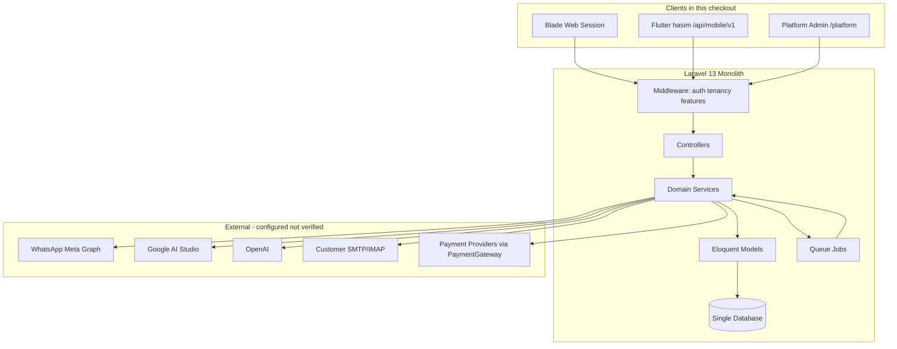
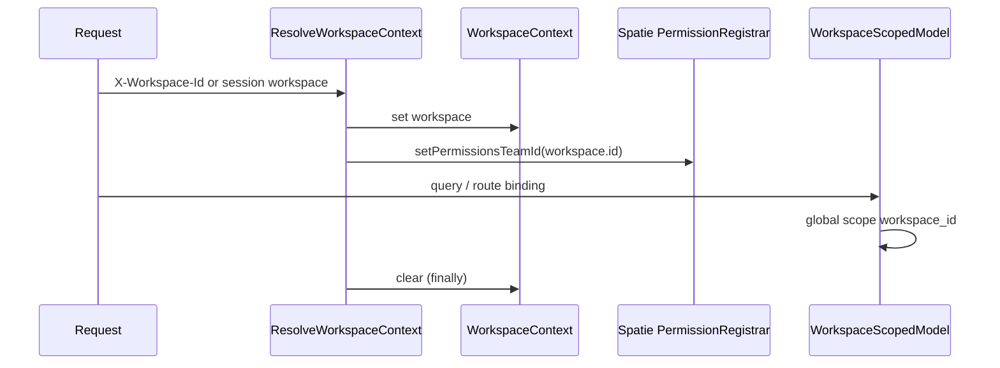
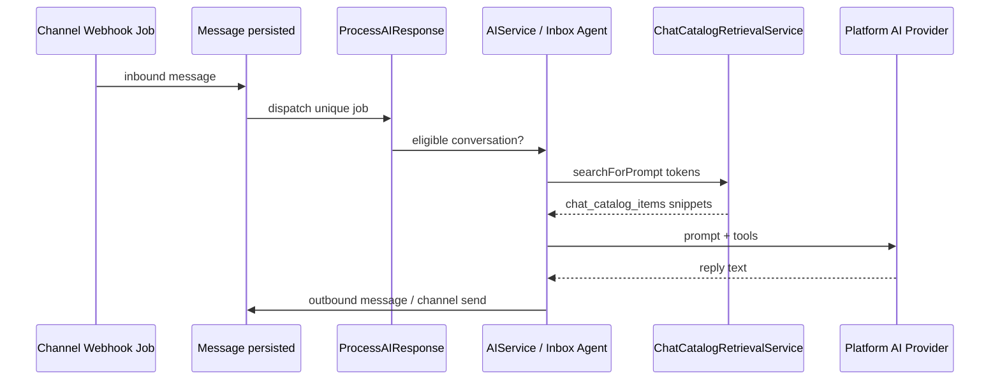
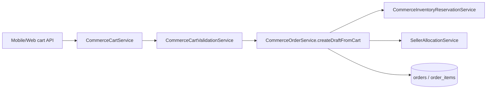
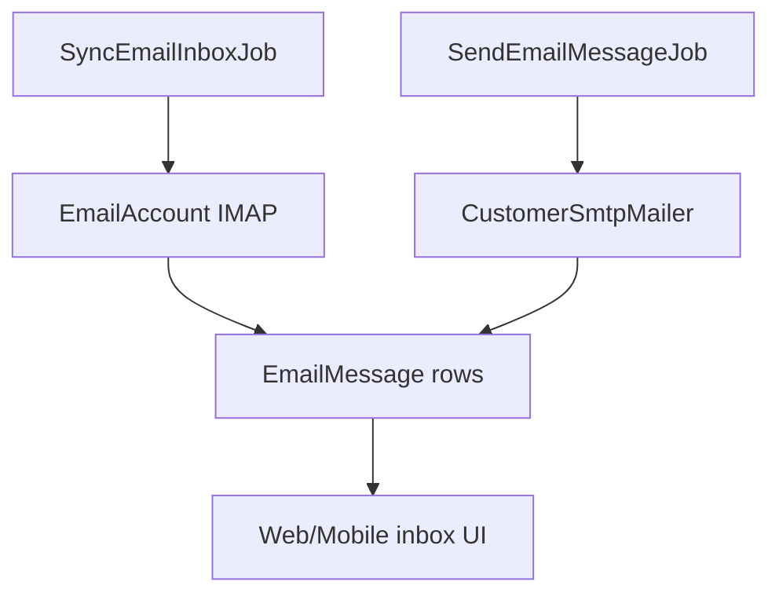
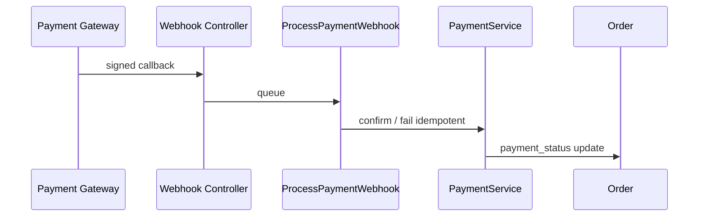

# Architecture and Flows — HASEM Discovery Audit

## 1. Overall system (evidence-based)

**Note:** Finance API and Cashier API clients are **documented** but **not wired in this route tree**.

**Evidence:** `bootstrap/app.php`, `routes/api.php`, `AGENTS.md`.

---

## 2. Request lifecycle (typical workspace web)

1. `routes/web.php` → middleware stack: `auth`, `workspace.selected`, `workspace.member`, often `workspace.feature:*`
2. Controller uses `InteractsWithWorkspace` → `WorkspaceContext`
3. Load `WorkspaceScopedModel` (global scope filters `workspace_id`)
4. Domain logic in `app/Services/{Domain}/`
5. Blade response or redirect

**Evidence:** `app/Http/Controllers/Workspace/Concerns/InteractsWithWorkspace.php`; `WorkspaceScopedModel::resolveRouteBinding` lines 16–34.

---

## 3. Mobile API lifecycle

1. Prefix `/api/mobile/v1` (`routes/api.php` 94–96)
2. `auth:sanctum` + `workspace.resolve` + `workspace.member` (+ feature/throttle on subgroups)
3. `App\Http\Controllers\Api\Mobile\V1\*`
4. JSON resources / MobileController patterns

**Evidence:** `routes/mobile.php` (auth block lines 48+, inbox block ~153+).

---

## 4. Tenancy and authorization

**Fail-closed binding:** Authenticated user without workspace context → route binding returns null (404), not cross-tenant row.

**Evidence:** `app/Models/WorkspaceScopedModel.php` lines 24–26; `ResolveWorkspaceContext.php` lines 37–41.

---

## 5. Chat catalog → AI reply (simplified)

**Evidence:** `app/Jobs/ProcessAIResponse.php`; tests referencing `ChatCatalogRetrievalService` in inbox tool tests.

**Not verified:** Live LLM call behavior (network disabled in audit).

---

## 6. Commerce cart → order (chat domain)

Explicit separation from finance product orders:

**Evidence:** `CommerceOrderService.php` class docblock lines 25–30.

Payment link step **blocked** for commerce source:

**Evidence:** `PaymentService.php` lines 31–33.

---

## 7. Email lifecycle (workspace mailbox)

Distinct from Laravel system mailer used for password reset (Breeze).

**Evidence:** `app/Jobs/SyncEmailInboxJob.php`; `app/Services/Email/CustomerSmtpMailer.php`.

---

## 8. Payment webhook (merchant orders)

**Evidence:** `app/Jobs/ProcessPaymentWebhook.php`; CSRF except webhook paths `bootstrap/app.php` 45–49.

**Unverified:** Signature verification details per provider (read in webhook controllers — not fully traced in audit).

---

## 9. Scheduler & background work

| Scheduled | File |
| --- | --- |
| Stories expiry | `routes/console.php` line 13 |
| Subscription trials/renewals/dunning | lines 30–32 |
| Worker engagement expiry | line 33 |
| DB backup / verify | lines 34–35 |
| Ops alerts, webhook retention | lines 36–37 |

Jobs directory: 25 job classes (inbound channel, AI, email, payment, push, media).

---

## 10. Broadcasting / realtime

- Channels: `routes/channels.php`
- Broadcasting auth prefix `api` + Sanctum (`bootstrap/app.php` 40–42)
- Inbox client payload built in `conversations/index.blade.php` via `InboxBroadcastConfig`

**Runtime verified:** No.

---

## 11. Flutter boundary

- Hasim app: Dio client to `/api/mobile/v1`, secure storage for token + workspace id
- Must not compute tax/GL locally (finance app rule — app missing here)

**Evidence:** `apps/hasim/pubspec.yaml` dependencies; `AGENTS.md`.

---

## Uncertain / unverified relationships

- POS sync ↔ `orders` table linkage (migrations add `pos_*` columns; POS PHP missing)
- Finance invoice posting ↔ inventory (services missing in tree)
- Electronic menu ← POS items (documented; renderer not traced)

Label: **unverified** until full PHP tree available.

**No code was modified for this document.**
