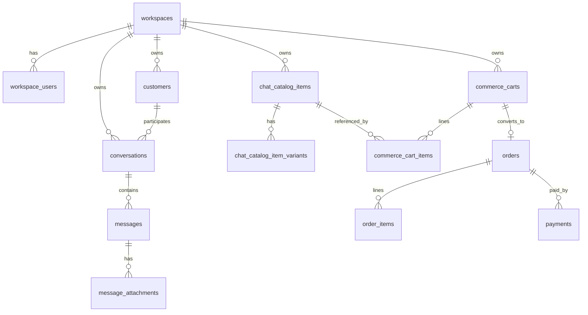

# Database and Relationships — HASEM Discovery Audit

**Source:** `database/migrations/*.php` only (183 migration files; **226** unique `Schema::create` table names extracted). No production DB access.

---

## 1. Table inventory by module (high level)

| Module | Representative tables |
| --- | --- |
| Tenancy & identity | `workspaces`, `workspace_users`, `workspace_feature_flags`, `users`, `auth_identities`, `platform_admins`, `platform_ai_settings` |
| Chat / inbox | `conversations`, `messages`, `message_attachments`, `conversation_user_states`, `channel_outbound_deliveries`, `inbox_agent_memories`, `customer_channel_identities` |
| Chat catalog | `chat_catalogs`, `chat_catalog_items`, `chat_catalog_item_variants`, `chat_catalog_digital_inventory_*`, `chat_catalog_product_templates` |
| Commerce engine | `commerce_carts`, `commerce_cart_items`, `commerce_inventory_reservations`, `commerce_sellers`, `commerce_intelligence_*` |
| Orders & payments | `orders`, `order_items`, `payments`, `payment_gateways`, `webhook_events`, `api_idempotency_keys` |
| Finance (schema) | `finance_invoices`, `finance_invoice_items`, `finance_journal_entries`, `finance_journal_entry_lines`, `finance_accounts`, `finance_expenses`, `finance_payroll_*`, `products`, `categories`, `inventory_movements` |
| POS (schema) | `pos_menu_items`, `pos_item_categories`, `pos_cashier_invoices`, `pos_sync_operations`, `dining_tables`, `table_sessions` |
| Email | `email_accounts`, `email_messages`, `email_attachments`, `email_campaigns`, `email_contacts`, `email_webhook_events` |
| AI | `ai_settings`, `ai_logs`, `ai_employees`, `ai_employee_*`, `finance_ai_conversations` (finance AI schema) |
| Workforce | `worker_engagements`, `worker_work_sessions`, `worker_earning_*`, `worker_disputes`, `worker_payout_records` |
| Subscriptions | `plans`, `subscriptions`, `subscription_checkout_sessions`, `subscription_billing_attempts` |
| E-invoicing | `e_invoice_documents`, `e_invoice_certificates`, `egs_units`, `egs_onboarding`, `egs_credentials` |
| Appointments / website | `appointment_*`, website-related tables in appointment/website migrations |
| Ops | `audit_logs`, `failed_jobs`, `cache`, `jobs` |

---

## 2. Tenancy column

**~100+ migrations** reference `workspace_id` (grep count across migrations).

Pattern: tenant-owned business rows include `workspace_id` indexed; enforced in app via `WorkspaceScopedModel`.

**Evidence:** `app/Models/WorkspaceScopedModel.php`; e.g. `create_conversations_table`, `create_customers_table`.

### Platform-global tables (no workspace_id — expected)

- `platform_admins`, `platform_ai_settings`, `platform_site_settings`
- `plans` (SaaS catalog — verify usage)
- Laravel system: `cache`, `jobs`, `failed_jobs`, `personal_access_tokens`

### Requires careful handling

- `users` — global; linked via `workspace_users`
- Webhook events — scoped per migration `scope_webhook_events_external_event_unique_by_workspace`

---

## 3. Entity relationship (core chat + commerce)

Chat catalog IDs stored on commerce cart lines and order items (snapshot pattern — see `CommerceOrderService`).

---

## 4. Product / catalog relationship map (logical)

| Entity A | Entity B | Relationship | Code responsible |
| --- | --- | --- | --- |
| `chat_catalog_items` | `commerce_cart_items` | FK `chat_catalog_item_id` | Commerce cart models/services |
| `chat_catalog_items` | AI retrieval | Token search, no FK to `products` | `ChatCatalogRetrievalService` |
| `pos_menu_items` | `products` | Optional `product_id` mapping | Migration `add_product_id_to_pos_menu_items` — **not** auto-sync |
| `products` | Finance invoices | Line items (documented) | **PHP missing in tree** |
| Chat catalog | Finance catalog | **No inheritance** | `docs/audit/DOMAIN-CATALOG-SEPARATION.md` |

---

## 5. Order / payment / invoice (schema level)

- `orders` — used by commerce engine (`source` field distinguishes flows — see PaymentService commerce check)
- `payments` — links to `orders`; billable checkout columns in migration `add_billable_checkout_to_payments_table`
- `finance_invoices` — separate ERP document store (models absent locally)

**Risk:** Same `orders` table may represent multiple semantic order types; consumers must respect `source` and line identity columns.

---

## 6. Email & messaging

- `email_messages` belong to `email_accounts` (workspace-scoped accounts)
- `conversations` / `messages` — omnichannel inbox separate from `email_messages` (unified in UI only)

---

## 7. Idempotency & uniqueness (selected)

| Mechanism | Evidence |
| --- | --- |
| API idempotency keys workspace-bound | migration `p1c_idempotency_workspace_bound` |
| AI reply job uniqueness | `ProcessAIResponse::uniqueId()` lines 45–49 |
| Webhook external event per workspace | migration `scope_webhook_events_external_event_unique_by_workspace` |
| Treasury transfer unique ref | documented in `HASEM_IMPLEMENTATION_STATUS.md` (finance service not in tree) |
| Commerce cart → order idempotency key | `CommerceOrderService::createDraftFromCart` param validation lines 67–70 |

---

## 8. Soft deletes

Used on several models (e.g. `PlatformAdmin` SoftDeletes — `app/Models/PlatformAdmin.php` line 16). Full matrix not enumerated — **Partial** audit coverage.

---

## 9. Orphan & deletion risks

- Deleting workspace without cascade plan → orphaned rows (depends on FK ON DELETE in each migration — not fully audited)
- Chat catalog digital units vs pools — reservation release on order cancel (logic in `CommerceInventoryReservationService` — **not runtime verified**)
- Removing payment gateway mid-checkout → pending `payments` rows

---

## 10. SQLite vs MySQL

PHPUnit forces SQLite `:memory:` (`phpunit.xml` lines 27–28). CI also documents MariaDB job in `composer.json` scripts `test:ci-mariadb`.

**Behavior differences:** Documented DATE_FORMAT fixes for finance dashboards in implementation status — **not re-verified**.

**No migrations or data were modified.**
