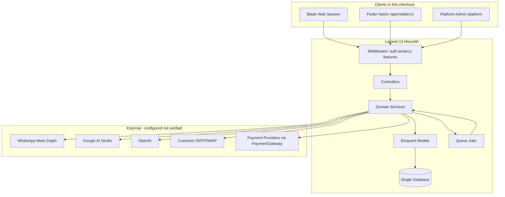
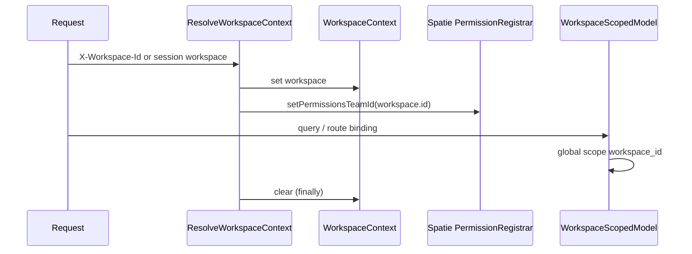
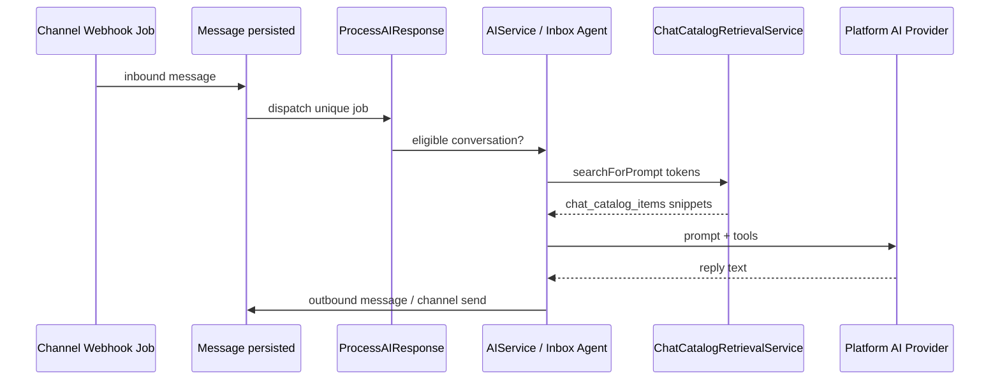
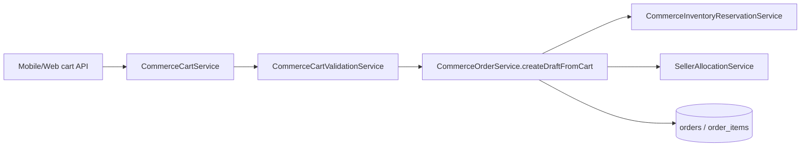
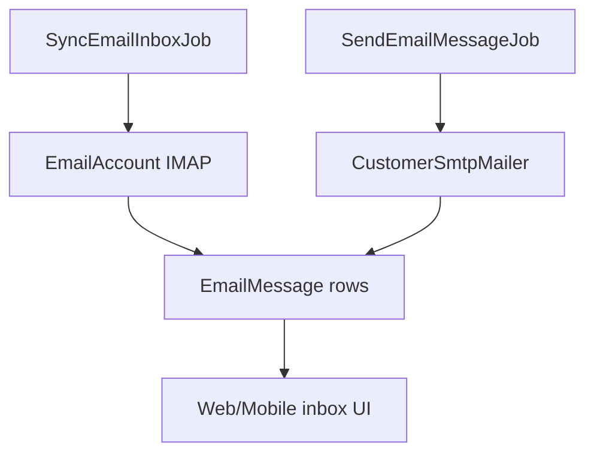
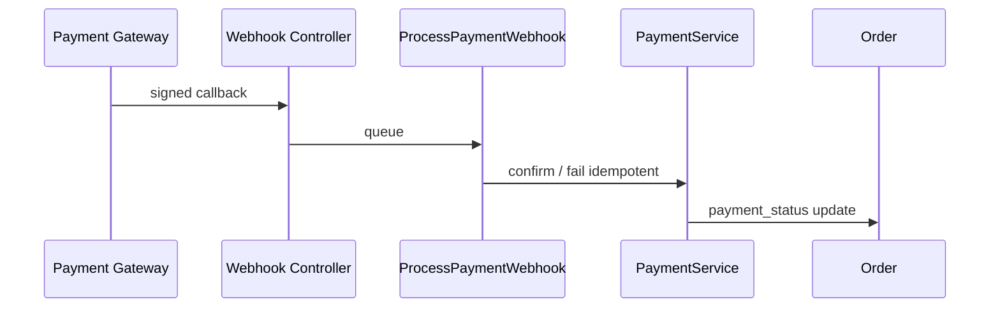
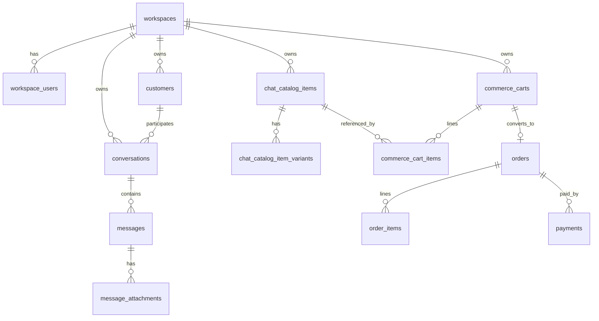

# HASEM — Full Discovery & Engineering Audit (Combined)

**Audit date:** 2026-10-12  
**Scope:** `/home/deploy/aihasan/aihasan` — static discovery only  
**Method:** Manifests, routes, models, services, migrations, tests, docs. No production DB, no test execution, no application code changes.

## Table of contents

- [A. Executive Summary](#a-executive-summary)
- [B. Module Inventory](#b-module-inventory)
- [C. Architecture and Flows](#c-architecture-and-flows)
- [D. Database and Relationships](#d-database-and-relationships)
- [E. Products, Catalogs, and Commerce](#e-products-catalogs-and-commerce)
- [F. API and Flutter](#f-api-and-flutter)
- [G. Security and Tests](#g-security-and-tests)
- [H. Change Impact Map](#h-change-impact-map)
- [I. Open Questions](#i-open-questions)

---


# A. Executive Summary


**Audit date:** 2026-10-12  
**Scope:** Evidence-based static discovery of `/home/deploy/aihasan/aihasan`  
**Method:** Manifests, routes, models, services, migrations, tests, docs cross-check. No production DB, no test execution, no code changes.

---

## What HASEM is (documented intent)

HASEM is designed as a **modular Laravel monolith** (PHP 8.3, Laravel 13) with **one database** and **`workspace_id` tenancy**. Client surfaces include Blade web, platform admin, mobile API (`/api/mobile/v1`), and (per specification) finance API (`/api/finance/v1`) and cashier API (`/api/cashier/v1`), plus Flutter apps `hasim`, `hasim_finance`, and `hasim_cashier`.

**Evidence:** `AGENTS.md`, `docs/HASEM_MASTER_PLATFORM_SPEC.md`, `composer.json` (PHP `^8.3`, `laravel/framework` `^13.17`).

Official product rule: **three functional catalogs** — Finance (`products`), Cashier (`pos_menu_items`), Chat (`chat_catalog_items`) — do not inherit from each other.

**Evidence:** `docs/audit/DOMAIN-CATALOG-SEPARATION.md`, `docs/HASEM_MASTER_PLATFORM_SPEC.md` §2.

---

## Critical environmental finding (this checkout)

The **checked-out tree on this server is not a complete mirror** of the architecture described in master docs and prior audits.

| Expected (docs / migrations / tests) | Present in PHP/routes on disk |
| --- | --- |
| `routes/finance-api.php`, `routes/cashier.php` | **Not found** (`routes/` has 8 files only) |
| `/api/finance/v1/*` route registration | **Not registered** in `bootstrap/app.php` / `routes/api.php` (only `mobile/v1` group) |
| `app/Models/Product.php`, finance models/services | **Not found** (~82 models; no `Product`, no `app/Services/Finance/`) |
| Finance workspace web routes in `routes/web.php` | **No matches** for finance/invoice/ledger |
| `apps/hasim_finance`, `apps/hasim_cashier` | **Not present** under `apps/` (only `apps/hasim/`) |
| ~226 tables in migrations | Migrations **present** (including `finance_*`, `pos_*`) |

**Status:** **Unknown / requires manual verification** — whether this is an intentional deployment slice, an incomplete clone, or files excluded from sync.

**Implication:** Implementation maturity for Finance ERP and POS **cannot be verified from application code in this tree**; it must be inferred from migrations + documentation + tests (which reference classes that may be absent here).

**Evidence:** `find apps/` → only `hasim`; `ls app/Models` → no `Product.php`; `glob routes/finance-api.php` → 0 files; `grep finance routes/web.php` → empty.

---

## What is clearly implemented in this checkout

### Communication & inbox (Chat domain)

- Unified inbox UI (Blade), conversations, messages, handoff, worker inbox reuse.
- **Evidence:** `resources/views/workspace/conversations/index.blade.php`, `app/Http/Controllers/Workspace/ConversationController.php`, `app/Http/Controllers/Worker/WorkerInboxController.php` (returns same view).
- Mobile API v1 for conversations, email, stories, catalog, commerce carts/orders, AI settings/employees.
- **Evidence:** `routes/mobile.php`, `routes/api.php` lines 94–96.

### Chat catalog & commerce order engine (Chat catalog → orders)

- Models: `ChatCatalogItem`, variants, digital inventory, templates.
- Services: `ChatCatalogRetrievalService` (AI grounding), `CommerceOrderService` (explicitly **not** legacy finance `OrderService`).
- **Evidence:** `app/Services/Commerce/CommerceOrderService.php` docblock lines 25–30; `app/Services/Chat/ChatCatalogRetrievalService.php` (referenced in tests).

### Inbox AI

- Job-driven replies: `ProcessAIResponse`, inbox agent tools, platform-wide model via `PlatformAiConfiguration`.
- **Evidence:** `app/Jobs/ProcessAIResponse.php`; `app/Services/Platform/PlatformAiConfiguration.php`.

### Email (workspace-connected mailboxes)

- Models: `EmailAccount`, `EmailMessage`, campaigns, contacts; jobs `SyncEmailInboxJob`, `SendEmailMessageJob`.
- **Evidence:** `app/Models/EmailAccount.php`, `app/Jobs/SyncEmailInboxJob.php`, `app/Services/Email/*`.

### Channels & webhooks

- WhatsApp, Meta (Facebook/Instagram), Telegram, TikTok webhook controllers; outbound delivery jobs.
- **Evidence:** `routes/web.php` webhook routes; `app/Http/Controllers/Webhook/*`; `app/Jobs/ProcessIncomingWhatsAppMessage.php`.

### Workforce (independent workers)

- Engagements, inbox capability gating, mobile worker API, platform admin verification/payout routes.
- **Evidence:** `app/Models/Worker/*`, `routes/mobile.php` worker prefix; `routes/platform.php` worker-* routes.

### Tenancy & security primitives

- `WorkspaceScopedModel`, `ResolveWorkspaceContext`, `EnsureWorkspaceMembership`, `EnsureFeatureAccess`, Spatie teams.
- **Evidence:** `app/Models/WorkspaceScopedModel.php`, `app/Http/Middleware/ResolveWorkspaceContext.php`, `bootstrap/app.php` middleware aliases.

### Subscriptions & platform admin

- SaaS plans/subscriptions (models present); isolated `platform_admin` guard and `/platform/*` routes.
- **Evidence:** `routes/platform.php`, `app/Http/Controllers/Platform/AuthController.php`.

---

## Flutter clients (this checkout)

| App | Path | SDK | API (intended) |
| --- | --- | --- | --- |
| Hasim (chat) | `apps/hasim/` | Dart `^3.9.0` (`pubspec.yaml`) | `/api/mobile/v1` |
| Hasim Finance | Documented only | — | `/api/finance/v1` — **app missing here** |
| Hasim Cashier | Documented only | — | `/api/cashier/v1` — **app missing here** |

**Evidence:** `apps/hasim/pubspec.yaml`; `README.md` lines 49–50 vs `ls apps/`.

---

## Tests & CI (static)

- **~293** PHPUnit test files under `tests/` (file count only; **not executed** in this audit).
- CI: `.github/workflows/ci.yml` — Pint, PHPUnit (SQLite in-memory per `phpunit.xml`).
- **Not verified:** pass/fail on this checkout (dev dependencies may be incomplete; `php artisan test` was unavailable in one environment session).

---

## Principal risks (for owners)

1. **Documentation vs disk drift** — Finance/POS described as production-ready in `docs/` but PHP/routes absent locally → deployment/replica confusion.
2. **Schema wider than code** — 226 migration tables including finance/POS; running app without matching PHP may be broken or partial.
3. **Commerce payments explicitly gated** — `PaymentService::createPaymentLink` throws for `order.source === 'commerce'`.
4. **Platform AI model allow-list** — Misconfigured platform model breaks pages loading presets (`PlatformAiConfiguration::resolvePair`).
5. **Cross-workspace IDOR** — Mitigated by design (`WorkspaceScopedModel`, dedicated tests); must remain on all new routes.

---

## Audit deliverables

All reports: `docs/audit/discovery-2026-10-12/`

**Confirmation:** No application source, schema, config, dependencies, or production data was modified during this audit.

---

# B. Module Inventory


Legend: **Implemented (code)** | **Partial** | **Schema/docs only** | **Not in tree** | **Unknown (runtime)**

Each row cites primary evidence. Line numbers refer to files read during audit.

---

## 1. Identity, auth, registration

| Field | Detail |
| --- | --- |
| Purpose | Web session login (Breeze), Sanctum API tokens, OTP/social hooks, platform admin guard |
| Status | **Implemented (code)** for web + mobile auth; platform admin separate |
| Models/tables | `users`, `auth_identities`, `personal_access_tokens` (migration); `User`, `AuthIdentity` |
| Routes | `routes/auth.php`, `routes/api.php` `/auth/*`, `routes/mobile.php` `/auth/*`, `routes/platform.php` login |
| Services | `app/Services/Auth/*`, `app/Services/Mobile/MobileAuthService.php` |
| UI | Blade `resources/views/auth/*`; Flutter `apps/hasim/lib/features/auth/` |
| Tenancy | User is global; workspace via membership |
| Tests | `tests/Feature/Feature/Mobile/*Auth*` (exist; not run) |
| Dependencies | Spatie permissions, Sanctum |
| Risk if changed | Breaks all surfaces |

**Evidence:** `bootstrap/app.php` guards; `app/Http/Controllers/Platform/AuthController.php` lines 20–38 (platform login validation).

---

## 2. Workspaces, membership, switching

| Field | Detail |
| --- | --- |
| Purpose | Multi-tenant workspaces; session `current_workspace_id`; header `X-Workspace-Id` on API |
| Status | **Implemented (code)** |
| Models | `Workspace`, `WorkspaceUser`, `WorkspaceFeatureFlag` |
| Middleware | `ResolveWorkspaceContext`, `EnsureWorkspaceSelected`, `EnsureWorkspaceMembership` |
| Services | `WorkspaceResolverService`, `WorkspaceContext` |
| Flutter | `apps/hasim/lib/features/workspace/presentation/workspace_picker_screen.dart` |
| Tests | Cross-workspace tests e.g. `CrossWorkspaceIdorTest` |
| Dependencies | Spatie `setPermissionsTeamId` in `ResolveWorkspaceContext.php` lines 31–32 |

**Evidence:** `app/Http/Middleware/ResolveWorkspaceContext.php`; `app/Models/WorkspaceScopedModel.php`.

---

## 3. RBAC & feature flags

| Field | Detail |
| --- | --- |
| Purpose | Spatie roles/permissions per workspace; plan entitlements |
| Status | **Implemented (code)** |
| Services | `FeatureAccessService`, `EnsureFeatureAccess` |
| Tests | Feature gate tests under `tests/Feature/Feature/Mobile/Mobile*FeatureGate*` |
| Docs vs code | Receptionist/accountant as Spatie roles; membership enum still owner/admin/manager/agent/member — **Partial** UX |

**Evidence:** `app/Http/Middleware/EnsureFeatureAccess.php` lines 21–44; `docs/audit/DOMAIN-CATALOG-SEPARATION.md` lines 33–35.

---

## 4. Customers & lightweight CRM

| Field | Detail |
| --- | --- |
| Purpose | Customers, notes, tags, groups; CRM leads (`crm_leads` per migrations) |
| Status | **Implemented (code)** for customers; leads **Unknown** (no `CrmLead` model in `app/Models` listing) |
| Models | `Customer`, `CustomerNote`, `CustomerTag`, `CustomerGroup` |
| Routes | Web workspace customers; mobile `/customers`; inbox links |
| Tests | IDOR in `CrossWorkspaceIdorTest` |

---

## 5. Finance / Commerce catalog (`products`)

| Field | Detail |
| --- | --- |
| Purpose | ERP products, inventory, invoices, GL (per master spec) |
| Status in **this tree** | **Schema/docs only** — migrations include `products`, `finance_invoices`, etc.; **no** `Product` model or `app/Services/Finance/` |
| Routes | **Not in tree** (`finance-api.php` missing) |
| Flutter | **Not in tree** (`apps/hasim_finance` missing) |
| Tests | Many `tests/Feature/Feature/Finance/*` reference finance — **may not load on this checkout** |
| Dependencies (documented) | InvoiceService, AccountingService, TaxService |

**Evidence:** `database/migrations/2026_08_18_151003_create_products_table.php`; absent `app/Models/Product.php`.

---

## 6. Cashier / POS catalog (`pos_menu_items`)

| Field | Detail |
| --- | --- |
| Purpose | POS menu, tables, sync, cashier API |
| Status | **Schema/docs only** in this tree (migrations `pos_menu_items`, `pos_cashier_invoices`; no POS controllers found in quick inventory) |
| Flutter | **Not in tree** |
| Docs | `docs/cashier-api.md`, `docs/hasim-cashier-status.md` |

---

## 7. Chat catalog (`chat_catalog_items`)

| Field | Detail |
| --- | --- |
| Purpose | Sellable items for chat AI + mobile catalog + commerce carts |
| Status | **Implemented (code)** |
| Models | `ChatCatalogItem`, variants, media, digital pools/units, templates |
| Controllers | `ChatCatalogController`, mobile `ChatCatalogController`, settings |
| Services | `ChatCatalogRetrievalService`, chat catalog CRUD services |
| AI | `SearchProductsTool`, `GetProductIntelligenceTool` use chat catalog IDs |
| Tests | `ChatCatalogProductTemplateTest`, `ArabicCatalogSearchTest`, `DomainCatalogSeparationTest` (referenced in docs) |
| Web UI | `resources/views/workspace/chat-catalog/*` |

**Evidence:** `app/Models/ChatCatalogItem.php`; `tests/Unit/Chat/ArabicCatalogSearchTest.php`.

---

## 8. Commerce order engine (chat checkout path)

| Field | Detail |
| --- | --- |
| Purpose | Carts → validated orders on `orders`/`order_items` with chat catalog line snapshots |
| Status | **Implemented (code)**; payment execution for commerce **Partial/stub** |
| Services | `CommerceOrderService`, `CommerceCartService`, `CommercePricingService`, inventory reservations |
| Mobile | `CommerceCartController`, `CommerceIntelligenceController` in `app/Http/Controllers/Api/Mobile/V1/` |
| Payment block | `PaymentService::createPaymentLink` rejects `source === 'commerce'` |

**Evidence:** `app/Services/Commerce/CommerceOrderService.php` lines 25–30, 61+; `app/Services/Payment/PaymentService.php` lines 31–33.

---

## 9. Orders, payments (merchant / legacy)

| Field | Detail |
| --- | --- |
| Purpose | Workspace orders, payment links, webhooks |
| Status | **Partial** — models + `PaymentService` present; full POS/finance order flows not verified here |
| Models | `Order`, `OrderItem`, `Payment`, `PaymentGateway` |
| Jobs | `CreatePaymentLink`, `ProcessPaymentWebhook` |
| Webhooks | CSRF exceptions in `bootstrap/app.php` lines 45–49 |

---

## 10. Subscriptions & SaaS billing

| Field | Detail |
| --- | --- |
| Purpose | Plans, subscriptions, checkout sessions, renewal/dunning schedules |
| Status | **Implemented (code)** (models + scheduled commands) |
| Scheduler | `routes/console.php` lines 13–37 |
| Platform | `routes/platform.php` plans/subscriptions CRUD |
| Tests | `BillingLifecycleTest` (referenced in docs) |

---

## 11. Unified inbox & messaging

| Field | Detail |
| --- | --- |
| Purpose | Omnichannel conversations, assignment, handoff, worker boundaries |
| Status | **Implemented (code)** |
| Models | `Conversation`, `Message`, `MessageAttachment`, `ChannelOutboundDelivery` |
| Web | Shared inbox blades under `resources/views/workspace/communication/inbox/` |
| Realtime | Reverb/broadcasting config; `resources/js/inbox-realtime.js` |
| Tests | `OmnichannelInboxTest`, `WorkerInboxTest`, `ConversationHandoffV2Test` |

---

## 12. WhatsApp / Meta / Telegram / TikTok

| Field | Detail |
| --- | --- |
| Purpose | Inbound webhooks → jobs; outbound send |
| Status | **Implemented (code)** for WhatsApp/Meta paths (tests exist); TikTok/Telegram **Partial** (connections + webhooks; capability matrix in docs) |
| Jobs | `ProcessIncomingWhatsAppMessage`, `ProcessIncomingFacebookMessage`, etc. |
| Docs | `docs/integrations/p6-provider-capability-matrix.md` |

---

## 13. Email (connected mailboxes)

| Field | Detail |
| --- | --- |
| Purpose | Per-workspace SMTP/IMAP mailboxes, sync, send, campaigns — **not** the same as Laravel `Mail` for system email |
| Status | **Implemented (code)** |
| Services | `CustomerSmtpMailer`, `SyncEmailInboxJob`, branding, template library |
| Mobile | `EmailController` mobile routes |
| Web | `Workspace\EmailController`, inbox hub views |
| Security scope | P0 audit docs on attachment/recipient scoping |

**Evidence:** `app/Services/Email/CustomerSmtpMailer.php`; `app/Jobs/SyncEmailInboxJob.php`.

---

## 14. Chat / inbox AI

| Field | Detail |
| --- | --- |
| Purpose | Auto-replies, tools, memory extraction, AI employees |
| Status | **Implemented (code)** |
| Components | `AIService`, inbox agent runtime, `AiEmployee` tables, `PlatformAiConfiguration` |
| Jobs | `ProcessAIResponse`, `ExtractInboxAgentMemoryJob` |
| Guardrails | `AiReplyEligibility`, tool security config in `config/ai.php` |
| Finance AI | **Schema/docs only** here (`finance_ai_*` tables; no finance API controllers) |

---

## 15. Appointments & website builder

| Field | Detail |
| --- | --- |
| Purpose | Booking, public websites per workspace |
| Status | **Partial** — `app/Models/Appointment/*`, `Website/*`; web routes exist in `web.php` (not fully traced) |
| Migrations | `appointment_*`, website tables |

---

## 16. Commerce intelligence

| Field | Detail |
| --- | --- |
| Purpose | Rules, attributes, compatibilities, recommendations on chat catalog entities |
| Status | **Implemented (code)** |
| Models | `CommerceIntelligenceProfile`, rules, compatibilities, etc. |
| Web | `Workspace/Commerce/CommerceIntelligenceController` |

---

## 17. Human workforce platform

| Field | Detail |
| --- | --- |
| Purpose | Independent workers, engagements, capabilities, earnings, disputes, payouts |
| Status | **Implemented (code)** |
| Models | `Worker/*` under `app/Models/Worker/` |
| Surfaces | Mobile worker API, worker web inbox, platform admin verification |

---

## 18. E-invoicing / ZATCA foundation

| Field | Detail |
| --- | --- |
| Purpose | EGS, certificates, UBL, crypto stubs (Saudi e-invoicing prep) |
| Status | **Partial** — migrations + extensive `docs/einvoicing/*`; finance API endpoints **not in route tree** |
| Tables | `e_invoice_*`, `egs_*` |

---

## 19. Platform admin & ops

| Field | Detail |
| --- | --- |
| Purpose | Site settings, AI model catalog, merchant/worker verification, ops health |
| Status | **Implemented (code)** |
| Routes | `routes/platform.php` |
| AI config | `PlatformAiConfiguration`, `PlatformAiSetting` model |

---

## 20. Notifications & push

| Field | Detail |
| --- | --- |
| Purpose | Database notifications, FCM push tokens, jobs |
| Status | **Implemented (code)** |
| Models | `DevicePushToken`; job `SendPushNotificationJob` |
| Flutter | Firebase in `apps/hasim/pubspec.yaml` |

---

## Modules documented but not verified in this tree

- Full **general ledger**, **payroll**, **treasury**, **purchase orders** (PHP services missing)
- **POS shifts**, **offline sync API** (cashier routes missing)
- **OCR**, **anomaly ML**, **warehouses/FIFO** — marked **Not started** in `docs/HASEM_IMPLEMENTATION_STATUS.md` lines 46, 76–84

---

## Absent or uncertain (explicit)

| Module | Conclusion |
| --- | --- |
| Finance ERP web UI | **Not in tree** (no finance routes in `web.php`) |
| Finance API | **Not in tree** |
| Cashier API | **Not in tree** |
| `hasim_finance` / `hasim_cashier` apps | **Not in tree** |
| Gmail OAuth as productized inbox | **Unknown** — search `Socialite` + email; IMAP/SMTP on `EmailAccount` confirmed |

**No application files were modified for this inventory.**

---

# C. Architecture and Flows


## 1. Overall system (evidence-based)



**Note:** Finance API and Cashier API clients are **documented** but **not wired in this route tree**.

**Evidence:** `bootstrap/app.php`, `routes/api.php`, `AGENTS.md`.

---

## 2. Request lifecycle (typical workspace web)

1. `routes/web.php` → middleware stack: `auth`, `workspace.selected`, `workspace.member`, often `workspace.feature:*`
2. Controller uses `InteractsWithWorkspace` → `WorkspaceContext`
3. Load `WorkspaceScopedModel` (global scope filters `workspace_id`)
4. Domain logic in `app/Services/{Domain}/`
5. Blade response or redirect

**Evidence:** `app/Http/Controllers/Workspace/Concerns/InteractsWithWorkspace.php`; `WorkspaceScopedModel::resolveRouteBinding` lines 16–34.

---

## 3. Mobile API lifecycle

1. Prefix `/api/mobile/v1` (`routes/api.php` 94–96)
2. `auth:sanctum` + `workspace.resolve` + `workspace.member` (+ feature/throttle on subgroups)
3. `App\Http\Controllers\Api\Mobile\V1\*`
4. JSON resources / MobileController patterns

**Evidence:** `routes/mobile.php` (auth block lines 48+, inbox block ~153+).

---

## 4. Tenancy and authorization



**Fail-closed binding:** Authenticated user without workspace context → route binding returns null (404), not cross-tenant row.

**Evidence:** `app/Models/WorkspaceScopedModel.php` lines 24–26; `ResolveWorkspaceContext.php` lines 37–41.

---

## 5. Chat catalog → AI reply (simplified)



**Evidence:** `app/Jobs/ProcessAIResponse.php`; tests referencing `ChatCatalogRetrievalService` in inbox tool tests.

**Not verified:** Live LLM call behavior (network disabled in audit).

---

## 6. Commerce cart → order (chat domain)



Explicit separation from finance product orders:

**Evidence:** `CommerceOrderService.php` class docblock lines 25–30.

Payment link step **blocked** for commerce source:

**Evidence:** `PaymentService.php` lines 31–33.

---

## 7. Email lifecycle (workspace mailbox)



Distinct from Laravel system mailer used for password reset (Breeze).

**Evidence:** `app/Jobs/SyncEmailInboxJob.php`; `app/Services/Email/CustomerSmtpMailer.php`.

---

## 8. Payment webhook (merchant orders)



**Evidence:** `app/Jobs/ProcessPaymentWebhook.php`; CSRF except webhook paths `bootstrap/app.php` 45–49.

**Unverified:** Signature verification details per provider (read in webhook controllers — not fully traced in audit).

---

## 9. Scheduler & background work

| Scheduled | File |
| --- | --- |
| Stories expiry | `routes/console.php` line 13 |
| Subscription trials/renewals/dunning | lines 30–32 |
| Worker engagement expiry | line 33 |
| DB backup / verify | lines 34–35 |
| Ops alerts, webhook retention | lines 36–37 |

Jobs directory: 25 job classes (inbound channel, AI, email, payment, push, media).

---

## 10. Broadcasting / realtime

- Channels: `routes/channels.php`
- Broadcasting auth prefix `api` + Sanctum (`bootstrap/app.php` 40–42)
- Inbox client payload built in `conversations/index.blade.php` via `InboxBroadcastConfig`

**Runtime verified:** No.

---

## 11. Flutter boundary

- Hasim app: Dio client to `/api/mobile/v1`, secure storage for token + workspace id
- Must not compute tax/GL locally (finance app rule — app missing here)

**Evidence:** `apps/hasim/pubspec.yaml` dependencies; `AGENTS.md`.

---

## Uncertain / unverified relationships

- POS sync ↔ `orders` table linkage (migrations add `pos_*` columns; POS PHP missing)
- Finance invoice posting ↔ inventory (services missing in tree)
- Electronic menu ← POS items (documented; renderer not traced)

Label: **unverified** until full PHP tree available.

**No code was modified for this document.**

---

# D. Database and Relationships


**Source:** `database/migrations/*.php` only (183 migration files; **226** unique `Schema::create` table names extracted). No production DB access.

---

## 1. Table inventory by module (high level)

| Module | Representative tables |
| --- | --- |
| Tenancy & identity | `workspaces`, `workspace_users`, `workspace_feature_flags`, `users`, `auth_identities`, `platform_admins`, `platform_ai_settings` |
| Chat / inbox | `conversations`, `messages`, `message_attachments`, `conversation_user_states`, `channel_outbound_deliveries`, `inbox_agent_memories`, `customer_channel_identities` |
| Chat catalog | `chat_catalogs`, `chat_catalog_items`, `chat_catalog_item_variants`, `chat_catalog_digital_inventory_*`, `chat_catalog_product_templates` |
| Commerce engine | `commerce_carts`, `commerce_cart_items`, `commerce_inventory_reservations`, `commerce_sellers`, `commerce_intelligence_*` |
| Orders & payments | `orders`, `order_items`, `payments`, `payment_gateways`, `webhook_events`, `api_idempotency_keys` |
| Finance (schema) | `finance_invoices`, `finance_invoice_items`, `finance_journal_entries`, `finance_journal_entry_lines`, `finance_accounts`, `finance_expenses`, `finance_payroll_*`, `products`, `categories`, `inventory_movements` |
| POS (schema) | `pos_menu_items`, `pos_item_categories`, `pos_cashier_invoices`, `pos_sync_operations`, `dining_tables`, `table_sessions` |
| Email | `email_accounts`, `email_messages`, `email_attachments`, `email_campaigns`, `email_contacts`, `email_webhook_events` |
| AI | `ai_settings`, `ai_logs`, `ai_employees`, `ai_employee_*`, `finance_ai_conversations` (finance AI schema) |
| Workforce | `worker_engagements`, `worker_work_sessions`, `worker_earning_*`, `worker_disputes`, `worker_payout_records` |
| Subscriptions | `plans`, `subscriptions`, `subscription_checkout_sessions`, `subscription_billing_attempts` |
| E-invoicing | `e_invoice_documents`, `e_invoice_certificates`, `egs_units`, `egs_onboarding`, `egs_credentials` |
| Appointments / website | `appointment_*`, website-related tables in appointment/website migrations |
| Ops | `audit_logs`, `failed_jobs`, `cache`, `jobs` |

---

## 2. Tenancy column

**~100+ migrations** reference `workspace_id` (grep count across migrations).

Pattern: tenant-owned business rows include `workspace_id` indexed; enforced in app via `WorkspaceScopedModel`.

**Evidence:** `app/Models/WorkspaceScopedModel.php`; e.g. `create_conversations_table`, `create_customers_table`.

### Platform-global tables (no workspace_id — expected)

- `platform_admins`, `platform_ai_settings`, `platform_site_settings`
- `plans` (SaaS catalog — verify usage)
- Laravel system: `cache`, `jobs`, `failed_jobs`, `personal_access_tokens`

### Requires careful handling

- `users` — global; linked via `workspace_users`
- Webhook events — scoped per migration `scope_webhook_events_external_event_unique_by_workspace`

---

## 3. Entity relationship (core chat + commerce)



Chat catalog IDs stored on commerce cart lines and order items (snapshot pattern — see `CommerceOrderService`).

---

## 4. Product / catalog relationship map (logical)

| Entity A | Entity B | Relationship | Code responsible |
| --- | --- | --- | --- |
| `chat_catalog_items` | `commerce_cart_items` | FK `chat_catalog_item_id` | Commerce cart models/services |
| `chat_catalog_items` | AI retrieval | Token search, no FK to `products` | `ChatCatalogRetrievalService` |
| `pos_menu_items` | `products` | Optional `product_id` mapping | Migration `add_product_id_to_pos_menu_items` — **not** auto-sync |
| `products` | Finance invoices | Line items (documented) | **PHP missing in tree** |
| Chat catalog | Finance catalog | **No inheritance** | `docs/audit/DOMAIN-CATALOG-SEPARATION.md` |

---

## 5. Order / payment / invoice (schema level)

- `orders` — used by commerce engine (`source` field distinguishes flows — see PaymentService commerce check)
- `payments` — links to `orders`; billable checkout columns in migration `add_billable_checkout_to_payments_table`
- `finance_invoices` — separate ERP document store (models absent locally)

**Risk:** Same `orders` table may represent multiple semantic order types; consumers must respect `source` and line identity columns.

---

## 6. Email & messaging

- `email_messages` belong to `email_accounts` (workspace-scoped accounts)
- `conversations` / `messages` — omnichannel inbox separate from `email_messages` (unified in UI only)

---

## 7. Idempotency & uniqueness (selected)

| Mechanism | Evidence |
| --- | --- |
| API idempotency keys workspace-bound | migration `p1c_idempotency_workspace_bound` |
| AI reply job uniqueness | `ProcessAIResponse::uniqueId()` lines 45–49 |
| Webhook external event per workspace | migration `scope_webhook_events_external_event_unique_by_workspace` |
| Treasury transfer unique ref | documented in `HASEM_IMPLEMENTATION_STATUS.md` (finance service not in tree) |
| Commerce cart → order idempotency key | `CommerceOrderService::createDraftFromCart` param validation lines 67–70 |

---

## 8. Soft deletes

Used on several models (e.g. `PlatformAdmin` SoftDeletes — `app/Models/PlatformAdmin.php` line 16). Full matrix not enumerated — **Partial** audit coverage.

---

## 9. Orphan & deletion risks

- Deleting workspace without cascade plan → orphaned rows (depends on FK ON DELETE in each migration — not fully audited)
- Chat catalog digital units vs pools — reservation release on order cancel (logic in `CommerceInventoryReservationService` — **not runtime verified**)
- Removing payment gateway mid-checkout → pending `payments` rows

---

## 10. SQLite vs MySQL

PHPUnit forces SQLite `:memory:` (`phpunit.xml` lines 27–28). CI also documents MariaDB job in `composer.json` scripts `test:ci-mariadb`.

**Behavior differences:** Documented DATE_FORMAT fixes for finance dashboards in implementation status — **not re-verified**.

**No migrations or data were modified.**

---

# E. Products, Catalogs, and Commerce


## Executive answer

HASEM is **architecturally designed** as **three independent catalogs** plus optional **POS→Finance inventory mapping**. In **this checkout**, the **Chat catalog and commerce order engine are implemented in PHP**; **Finance `products` and POS `pos_menu_items` are present in migrations and documentation** but **lack corresponding application code** (models/services/routes).

**Evidence:** `docs/audit/DOMAIN-CATALOG-SEPARATION.md`; missing `app/Models/Product.php`; present `ChatCatalogItem` model and services.

---

## 1. Three catalogs (design)

| Catalog | Table(s) | Created/edited via | Consumed by |
| --- | --- | --- | --- |
| Finance / Commerce ERP | `products`, `categories`, `product_variants`, `inventory_movements` | Documented: Finance web + `/api/finance/v1` | Invoices, COGS, inventory accounting |
| Cashier / POS | `pos_menu_items`, `pos_item_categories` | Documented: Cashier API + POS UI | POS orders, electronic menu |
| Chat | `chat_catalog_items` (+ variants, media, digital inventory) | Web `ChatCatalogController`, mobile API, templates | Hasim app, inbox AI retrieval, commerce carts |

**Does creating in one catalog create another?** **No** (explicit product decision).

**Evidence:** `DOMAIN-CATALOG-SEPARATION.md` lines 31–33.

**Optional link:** `pos_menu_items.product_id` → finance product for inventory — **mapping only**.

**Evidence:** migration `2026_08_31_160100_add_product_id_to_pos_menu_items.php`.

---

## 2. Chat catalog — implementation trace

### Creation / edit

- Web: `app/Http/Controllers/Workspace/Chat/ChatCatalogController.php` (+ digital inventory, templates, settings controllers)
- Mobile: `app/Http/Controllers/Api/Mobile/V1/ChatCatalogController.php`, `ChatCatalogSettingsController.php`
- Permissions: Spatie `chat.catalog.view`, `chat.catalog.manage` (per domain separation doc)

### Search / list

- Retrieval for AI: `App\Services\Chat\ChatCatalogRetrievalService::searchForPrompt`
- Tests: `tests/Unit/Chat/ArabicCatalogSearchTest.php`, performance bounded search test

### AI consumption

- Inbox tools (e.g. search products) use chat catalog, **not** `products` table
- **Evidence:** `tests/Unit/AI/Inbox/Tools/SearchProductsToolTest.php` mocks `ChatCatalogRetrievalService`

### Digital products

- Tables: `chat_catalog_digital_inventory_pools`, `chat_catalog_digital_inventory_units`
- Models: `ChatCatalogDigitalInventoryPool`, `ChatCatalogDigitalInventoryUnit`
- Fulfillment path tied to commerce reservations — **Partial** (reservation service exists; delivery automation not fully traced)

---

## 3. Commerce carts and orders (chat checkout)

### Flow

1. Cart CRUD (mobile API + validation services)
2. `CommerceOrderService::validateCartForOrder` → `CommerceCartValidationService`
3. `createDraftFromCart` with idempotency key → persists `Order` + `OrderItem` with chat catalog snapshots
4. Inventory: `CommerceInventoryReservationService`

**Explicit non-use of finance OrderService:**

```25:30:app/Services/Commerce/CommerceOrderService.php
 * Canonical creation service for Chat Catalog Commerce orders.
 *
 * It intentionally does not use the legacy OrderService: that service is a
 * Finance Product + InventoryService flow, while Commerce lines snapshot
 * Chat Catalog identities and reserve their own authoritative inventory.
```

### Payment links & gateways

- `PaymentService::createPaymentLink` **throws** when `$order->source === 'commerce'` with message *Commerce payment execution is not enabled in this phase.*

**Status:** Checkout/order creation **Implemented**; payment execution for commerce **Stub / not enabled**.

**Evidence:** `app/Services/Payment/PaymentService.php` lines 31–33.

### Seller allocations

- Marketplace-style seller splits: `SellerAllocationService`, `commerce_seller_allocations` tables
- **Evidence:** `app/Services/Commerce/SellerAllocationService.php`

---

## 4. Finance catalog & invoices (expected vs tree)

Documented capabilities (`docs/HASEM_IMPLEMENTATION_STATUS.md`):

- Invoices, credit notes, journal posting, tax, treasury, purchase orders
- Money helper: `app/Support/Money/Money.php` (**present**)

Missing in tree:

- `InvoiceService`, `AccountingService`, finance controllers, `Product` model

**Status:** **Schema/docs only** in this audit environment.

**Consequence if finance PHP removed from deploy:** Migrations still create `finance_*` tables; app cannot manage them via UI/API.

---

## 5. POS catalog (expected vs tree)

Documented:

- Offline-first cashier app, `/api/cashier/v1`, sync engine
- Tables: `pos_menu_items`, `pos_sync_operations`, etc.

Missing in tree:

- Cashier routes file, POS controllers (not found in controller inventory)

**Status:** **Schema/docs only** here.

---

## 6. Stock and accounting interactions

| Action | Chat commerce | Finance ERP (documented) |
| --- | --- | --- |
| Stock decrement | `commerce_inventory_reservations` | `inventory_movements` + GL via `InventoryAccountingService` |
| Invoice generation | Not wired from commerce orders in traced code | Finance invoice service |
| COGS | Not verified for chat orders | Documented in implementation status |

**Removing payment links:** Merchant orders using `PaymentService` would lose checkout URL creation; historical `payments` rows remain.

**Disabling gateway:** New checkouts fail; pending payments need manual resolution.

**Deleting chat catalog item:** Risk to active carts/reservations — depends on FK constraints and service validation (**not fully audited**).

---

## 7. Chat AI product delivery

- AI can **retrieve** catalog items and run commerce intelligence tools
- **Product delivery** (digital unit assignment) — logic in commerce/digital inventory services; end-to-end **Unknown (runtime)**
- Commerce orders from chat — **draft creation implemented**; payment **disabled**

---

## 8. Tests anchoring catalog separation

- `DomainCatalogSeparationTest` referenced in docs (finance vs chat vs POS)
- `ChatCatalogRetrievalServiceTest`, inbox tool tests

**Not executed** in this audit.

---

## 9. Change impact preview (catalog-specific)

| Change | Blast radius |
| --- | --- |
| Merge catalogs into one table | Breaks DOMAIN-CATALOG-SEPARATION, AI retrieval, POS sync, finance COGS |
| Enable commerce payments | `PaymentService`, webhooks, merchant eligibility, order status enums |
| Add SKU sync Finance→Chat | New integration service; no auto-sync today |
| Remove `products` table | Finance ERP dead; optional POS mapping broken |

**No code or schema was modified.**

---

# F. API and Flutter


## 1. HTTP surfaces (registered in this tree)

| Surface | Prefix | Route file | Auth |
| --- | --- | --- | --- |
| Legacy API | `/api/*` | `routes/api.php` | Sanctum + workspace middleware on subsets |
| Mobile (Hasim) | `/api/mobile/v1/*` | `routes/mobile.php` via `api.php` L94–96 | Sanctum; `X-Workspace-Id` |
| Web workspace | `/workspace/*` (and related) | `routes/web.php` | Session + workspace middleware |
| Platform admin | `/platform/*` | `routes/platform.php` | `platform_admin` guard |
| Webhooks | Various paths | `web.php` + `api.php` | Signatures / tokens (per controller) |
| Broadcasting auth | `/api/broadcasting/auth` | `bootstrap/app.php` L40–42 | Sanctum |

### Not registered in this tree

| Surface | Documented prefix | Status |
| --- | --- | --- |
| Finance API | `/api/finance/v1` | **Missing** `routes/finance-api.php` |
| Cashier API | `/api/cashier/v1` | **Missing** `routes/cashier.php` |

**Evidence:** `glob **/finance-api.php` → 0; `routes/api.php` ends with mobile group only.

---

## 2. Mobile API v1 — major groups (from `routes/mobile.php`)

| Group | Controllers (namespace `Api\Mobile\V1`) | Notes |
| --- | --- | --- |
| Auth / profile | `AuthController`, sessions | Throttle `mobile-login` |
| Worker | `WorkerAccountController` | Engagements, inbox, sessions, earnings, disputes |
| Conversations | `ConversationController` | Messages, read state |
| Email | `EmailController`, contacts, campaigns | Feature-gated |
| Stories | `StoryController` | |
| Catalog | `ChatCatalogController`, settings | |
| Commerce | `CommerceCartController`, intelligence | Carts/orders path |
| AI | `AiSettingsController`, `AiEmployeeController`, `AiController` | Plan feature `ai` |
| Channels | `ChannelController`, `ChannelConnectController` | OAuth connect flows |
| Customers | `CustomerController` | |
| Home / unread | `HomeController`, `UnreadController` | |

Contract reference: `docs/mobile-api.md` (compare to code — **owner should diff**).

Middleware highlights:

- `workspace.resolve`, `workspace.member`, `workspace.feature:*`, `inbox.actor`, `mobile.idempotency` (on writes)

**Evidence:** `bootstrap/app.php` middleware aliases lines 70–78.

---

## 3. Legacy `/api` routes (`routes/api.php`)

- Auth register/login/OTP/social
- Workspace-scoped resources: customers, conversations, messages, payments, WhatsApp, subscriptions, AI (legacy controllers under `App\Http\Controllers\Api\`)
- Throttle profile `legacy-api`
- Payment/subscription webhooks at bottom of file

**Note:** Overlap with mobile v1 exists historically — mobile is the primary Hasim contract.

---

## 4. Flutter: `apps/hasim`

| Item | Value |
| --- | --- |
| Package name | `hasim` (`pubspec.yaml` line 1) |
| SDK | `^3.9.0` |
| State / routing | Riverpod, go_router |
| HTTP | Dio |
| Storage | flutter_secure_storage, Hive, Drift (local DB for offline features) |
| Push | firebase_messaging |
| Auth | google_sign_in + mobile auth API |

### Feature modules (lib/)

- `features/conversations/` — inbox, chat screen, attachments
- `features/email/` — mailbox UI
- `features/settings/` — AI settings, plans, channels, worker capabilities
- `features/worker/` — engagements, worker inbox
- `features/stories/`, search, privacy/PIN, workspace picker

Architecture notes: `apps/hasim/ARCHITECTURE.md`, design system `docs/HASIM_FLUTTER_DESIGN_SYSTEM.md`.

### API integration pattern

Repositories under `features/*/data/*_repository.dart` call Dio with bearer token and workspace header (pattern seen in `auth_repository.dart`, `plan_channel_repository.dart` — representative).

**Runtime verified:** No.

---

## 5. Flutter: `hasim_finance` & `hasim_cashier`

| App | In this tree | Documented API |
| --- | --- | --- |
| `apps/hasim_finance` | **Absent** | `/api/finance/v1` — no local tax/GL math per AGENTS.md |
| `apps/hasim_cashier` | **Absent** | `/api/cashier/v1`, offline catalog |

README and audit docs describe Windows runners and test counts — **cannot verify** without repo paths.

---

## 6. Web Blade parity (communication module)

- Inbox: workspace + worker share `workspace.conversations.index` view
- Chat catalog admin: full CRUD blades
- Commerce intelligence/admin blades under workspace commerce namespace

Hasim Flutter targets mobile API; web uses session routes (not identical JSON).

---

## 7. Missing / partial integrations (evidence-based)

| Integration | Status |
| --- | --- |
| Finance Flutter ↔ finance API | **Not in tree** |
| Cashier ↔ cashier API | **Not in tree** |
| Commerce order → payment link in app | Blocked server-side for commerce source |
| Instagram/Messenger live backend | Documented as partial / coming-soon in DOMAIN-CATALOG-SEPARATION |
| Gmail OAuth inbox | **Unknown** — email uses `EmailAccount` SMTP/IMAP services |

---

## 8. API versioning

- Mobile: explicit `v1` prefix
- Finance: documented `v1` — not mounted
- Legacy `/api` — unversioned resources

Backward compatibility rule in master spec — **policy**; not mechanically verified.

**No API routes or Flutter files were modified.**

---

# G. Security and Tests


Static review only. **No exploitation, no production access, no test execution.**

Prior audit artifacts exist under `docs/audit/` (P0/P1 plans, SECURITY-AUDIT.md) — this report summarizes **code-evidenced** controls in the current tree and gaps.

---

## 1. Authentication & sessions

| Finding | Status | Evidence |
| --- | --- | --- |
| Web session auth (Breeze) | Implemented | `routes/auth.php` |
| API Sanctum tokens | Implemented | `config/auth.php`, mobile/legacy API groups |
| Platform admin isolated guard | Implemented | `routes/platform.php`, `Platform\AuthController` |
| Mobile 401 JSON message | Implemented | `bootstrap/app.php` exception render L87–93 |
| CSRF on web forms | Laravel default; exceptions for webhooks | `bootstrap/app.php` L45–49 |

**Not verified:** Session cookie flags in production (`SESSION_*` names only — values not read).

---

## 2. Tenancy & IDOR

| Finding | Status | Evidence |
| --- | --- | --- |
| Global scope on tenant models | Implemented | `WorkspaceScopedModel` |
| Route binding without workspace → null/404 | Implemented | `WorkspaceScopedModel::resolveRouteBinding` L24–26 |
| Dedicated cross-workspace tests | Implemented (tests exist) | `tests/Feature/Feature/Security/CrossWorkspaceIdorTest.php` |
| Workspace resolution from header/session | Implemented | `ResolveWorkspaceContext`, `WorkspaceResolverService` |

**Confidence:** High for patterns; **runtime** IDOR on every new endpoint — requires per-route review.

---

## 3. Authorization (RBAC)

- Spatie permission with team = workspace id
- Feature gates: `EnsureFeatureAccess` + plan entitlements
- Worker capabilities: `WorkerEngagementAuthorization` path in feature middleware L31–36
- Finance elevation (manager = finance) — documented as **changed** in P0-5 audit; finance controllers **not in tree** to re-verify

---

## 4. Mass assignment & policies

- Models use `Fillable` attributes (PHP 8 attributes pattern e.g. `PlatformAdmin`)
- Policies exist for some domains (conversation handoff `@can` in inbox blades)
- **Partial coverage:** Not all controllers audited for `$request->validated()` vs `$request->all()`

---

## 5. CORS / security headers

- `SecurityHeaders` middleware appended globally — `bootstrap/app.php` L52
- CORS config in Laravel — **not fully read** in audit

---

## 6. File upload & downloads

- Message attachments: `MessageAttachmentController`, channel media jobs
- Email attachments: scoped migration `scope_email_attachments_recipients_and_push_tokens`
- Merchant/worker document download routes on platform admin with authorized controllers

**Risk:** Attachment download must always assert workspace + conversation ownership — tests exist for workspace attachment isolation (`WorkspaceInboxTest`).

---

## 7. Webhooks

- CSRF disabled for webhook paths (required for external POST)
- Jobs: `ProcessPaymentWebhook`, `ProcessSubscriptionWebhook`, channel inbound jobs
- Idempotency: webhook event uniqueness per workspace (migration)

**Prior audit:** P0-7 webhook fail-closed secret — see `docs/audit/P0-7-WEBHOOK-FAIL-CLOSED-SECRET.md` (not re-run).

---

## 8. AI security boundary

| Topic | Evidence |
| --- | --- |
| Platform model allow-list | `PlatformAiConfiguration::assertAllowedPair` |
| Tool argument size limits | `config/ai.php` inbox_agent.security |
| No finance writes from inbox AI | Master spec rule; finance AI separate schema |
| Prompt grounding | Chat catalog retrieval + redaction in settings |
| Job uniqueness | `ProcessAIResponse` ShouldBeUnique |

**Risk:** Platform admin selects model outside allow-list → runtime exceptions (observed class of bug in production logs — **config operational risk**, not tenant IDOR).

Prior: `docs/audit/P1-B-AI-SECURITY-PRIVACY-COST.md`.

---

## 9. Rate limiting

- Throttles on login (platform, mobile), mobile writes, legacy API
- **Evidence:** `routes/platform.php` L30; mobile route middleware attributes

---

## 10. Secrets handling

- PHPUnit sets dummy `PLATFORM_ADMIN_PASSWORD`, empty AI keys — `phpunit.xml` L37–39
- Audit rule: **no `.env` values copied**
- Log redaction helpers referenced (e.g. webhook sanitizer in PaymentService imports)

---

## 11. Queue tenant context

- Jobs often accept `workspaceId` (e.g. `ProcessAIResponse` constructor L37–40) and use `WorkspaceContext::runFor`
- **Risk:** Jobs missing workspace context could leak or fail — spot-check only, not exhaustive

---

## Security findings summary (this pass)

| ID | Severity | Finding | Confidence |
| --- | --- | --- | --- |
| S1 | **High** | Deploy tree may omit finance/cashier routes while exposing full schema | High (structural) |
| S2 | **High** | Cross-tenant access relies on discipline on every new route/model | Medium (mitigated by tests + base model) |
| S3 | **Medium** | Commerce payments disabled but orders creatable — business logic abuse (draft spam) | Medium |
| S4 | **Medium** | Webhook endpoints without CSRF — require signature verification (verify per handler) | Medium |
| S5 | **Medium** | AI tool injection / exfil — bounded by tool security config; not red-teamed | Low-Medium |
| S6 | **Low** | Platform AI misconfiguration causes DoS on AI-heavy pages | Observed in ops |

**Recommended investigation (no auto-fix):** Full endpoint matrix pass using existing `docs/audit/SECURITY_ENDPOINT_MATRIX.md` against **complete** route list from production artifact.

---

## 12. Tests & CI

| Item | Value |
| --- | --- |
| Framework | PHPUnit 12 (`composer.json` require-dev) |
| Config | `phpunit.xml` — SQLite `:memory:` |
| Test files | **~293** `*Test.php` files (count only) |
| CI | `.github/workflows/ci.yml` — pint, phpunit jobs |
| Critical suite | `phpunit.critical.xml` referenced in composer scripts |
| MariaDB job | `test:ci-mariadb` script exists |

### Coverage themes (from filenames / docs)

- Cross-workspace IDOR
- Inbox, handoff, worker boundaries
- Chat catalog search + AI tools
- Mobile API feature gates
- Commerce cart validation
- Billing lifecycle (referenced)
- Finance core (tests exist — **may fail if finance code missing**)

### Test execution this audit

**Not run.** Reasons: user rules forbid destructive/production commands; environment had incomplete dev tooling in one session (`php artisan test` undefined when dev deps incomplete).

**Do not claim tests pass.**

### High-risk missing tests (inferred)

- End-to-end commerce payment when enabled (currently blocked)
- Full finance API regression (if restored to tree)
- Cashier offline sync conflict (if cashier app restored)
- Gmail OAuth if implemented later

---

## 13. Operational readiness (static)

| Requirement | Notes |
| --- | --- |
| Redis | Predis in composer; queue often Redis in prod docs — **Unknown here** |
| Scheduler | `routes/console.php` — needs cron |
| Reverb / broadcasting | Laravel Reverb package present |
| Storage | Attachment paths use Laravel storage — disk config not audited |
| Backups | Scheduled `backup:database` command |

**No tests were executed. No code was modified.**

---

# H. Change Impact Map


High-impact shared components and what breaks if they change. Based on **this checkout** + migrations/docs.

---

## 1. `WorkspaceScopedModel` + `WorkspaceContext`

| Depends on it | ~84 models in tree; all tenant queries |
| Consumers | Web, mobile API, jobs using `runFor` |
| Tests | `CrossWorkspaceIdorTest`, many feature tests |
| Break risk | Removing scope → **critical IDOR** |
| Safe boundary | Add new tenant models extending base; never disable scope in controllers |

**Evidence:** `app/Models/WorkspaceScopedModel.php`

---

## 2. `ResolveWorkspaceContext` middleware

| Depends on it | All `/api/mobile/v1` workspace routes, legacy API subsets |
| Break risk | Forgetting middleware on new API group → 403 or wrong tenant |
| Tests | Mobile workspace header tests |

---

## 3. `FeatureAccessService` / plans / `workspace_feature_flags`

| Depends on it | AI, email, commerce, channel features |
| Break risk | Plan key rename → silent feature denial |
| Docs | `docs/plans.md`, billing docs |

---

## 4. Chat catalog stack

**Files/services:** `ChatCatalogItem*`, `ChatCatalogRetrievalService`, web/mobile catalog controllers, template seeders

| Consumer | Impact if catalog schema changes |
| --- | --- |
| Inbox AI tools | Prompt grounding breaks |
| Commerce carts/orders | FK + snapshot columns |
| Commerce intelligence | Attribute/rule linkage |
| Worker engagement products | `worker_engagement_products.chat_catalog_item_id` |
| Flutter Hasim | Catalog screens, cart |

**Tests:** `ArabicCatalogSearchTest`, `ChatCatalogProductTemplateTest`, domain separation tests

**Safe boundary:** Additive columns on `chat_catalog_items`; avoid renaming without migration + API version bump.

---

## 5. Commerce order engine

**Core:** `CommerceOrderService`, `CommerceCartValidationService`, `CommerceInventoryReservationService`, `SellerAllocationService`

| Consumer | Impact |
| --- | --- |
| Mobile commerce API | Order create/validate |
| PaymentService (future) | Must handle `source=commerce` |
| Audit logs | `AuditLogService` calls |
| `orders` / `order_items` tables | Shared with other order sources |

**Do not** merge with finance `OrderService` without explicit migration — docblock forbids conflation.

---

## 6. `PaymentService` + gateways + webhooks

| Consumer | Impact |
| --- | --- |
| Merchant checkout | Payment links |
| Subscription billing | Separate webhook job |
| Commerce | **Currently blocked** — enabling touches eligibility + webhooks + order status |

**Tests:** Payment webhook tests (exist in suite)

---

## 7. Inbox + channel pipeline

**Components:** Conversation/Message models, webhook controllers, `ProcessIncoming*Message` jobs, `ChannelOutboundService`, `ProcessAIResponse`

| Consumer | Impact |
| --- | --- |
| Web inbox UI | Realtime + blades |
| Worker inbox | Same view, restricted actions |
| Mobile conversations API | Flutter primary UX |
| AI employees / handoff | Assignment + policies |

**Tests:** Large Worker/Inbox test folders

---

## 8. `PlatformAiConfiguration`

| Consumer | Impact |
| --- | --- |
| All AI replies | Model/provider selection |
| AI employee presets | `EmployeeModelPolicy` defaults |
| Platform admin UI | `/platform/ai` |

**Operational note:** Allow-list drift breaks preset loading and AI runtime.

---

## 9. Email subsystem

**Components:** `EmailAccount`, sync/send jobs, SMTP transport factory, mobile email API

| Distinct from | Laravel mailer for system emails |
| Impact if changed | Workspace mailbox feature breaks; campaigns/contacts cascade |

---

## 10. Finance stack (documented — PHP missing here)

If restored from full repo, expected blast radius:

- Tables: all `finance_*`, `products`, GL, payroll
- Apps: `hasim_finance`
- Routes: `/api/finance/v1`, finance web sidebar
- POS integration reads POS invoices — **read-only integration**, not catalog merge

**Change impact:** Invoice status enum, tax calculation, posted journal immutability — **high** (see master spec non-negotiables).

---

## 11. POS / cashier (documented — PHP missing here)

- Local SQLite in cashier app (Drift) — docs
- Sync operations table — server-side idempotency
- **Impact:** Menu changes, tax display rules, sync protocol version

---

## 12. Migrations (global)

183 migration files — **additive-only policy** per project rules.

**Risk:** Deploying migrations without matching PHP → schema/code drift.

---

## 13. Flutter `apps/hasim`

| Backend contract | `/api/mobile/v1` |
| Break if | Mobile breaking JSON shape, auth header requirements, feature gates |
| Independent | UI can ship faster than API — verify with contract tests |

---

## 14. Prior audit remediation matrix

Cross-reference: `docs/audit/AUDIT_REMEDIATION_MATRIX.md` for P0/P1 item ownership — not duplicated here.

---

## Safe modification boundaries (summary)

1. **Chat catalog + commerce** — isolated from finance products if separation preserved.
2. **Inbox/messaging** — keep webhook + job idempotency when adding channels.
3. **Tenancy** — never bypass `WorkspaceScopedModel` for convenience.
4. **Finance/POS** — do not change without full PHP tree + finance/cashier test suites green.

**No files were modified for this map.**

---

# I. Open Questions


These cannot be answered from the current checkout alone.

1. **Repository completeness** — Is `/home/deploy/aihasan/aihasan` a full git clone or a production deploy subset? Why are `routes/finance-api.php`, `routes/cashier.php`, `app/Services/Finance/`, and `apps/hasim_finance` / `apps/hasim_cashier` missing while migrations and docs reference them?

2. **Production vs documentation** — Does production at `hasim.online` run a different artifact (full monolith) than this workspace path?

3. **Finance module** — Are finance features served only from another branch/server, or were they removed intentionally from this deploy?

4. **Test suite health on canonical repo** — What is the current CI pass rate on `main`? (Not executed in this audit.)

5. **MySQL vs SQLite** — Which database engine runs production? Are there known SQLite/MySQL divergences beyond documented journal date formatting?

6. **Queue/redis** — Is Redis required in production for inbox AI, webhooks, email sync? (`QUEUE_CONNECTION` name only — value not read from `.env`.)

7. **Commerce payments roadmap** — When will `PaymentService` allow `order.source === 'commerce'`? Is checkout intentionally draft-only?

8. **Platform AI model** — Who owns allow-list updates when admins select models outside `config/ai.php` (production incident: `gemini-3.6-flash` vs allowed list)?

9. **Gmail** — Is Google OAuth inbox a planned feature or out of scope vs SMTP/IMAP `EmailAccount`?

10. **Data retention** — Legal retention for AI logs, email bodies, attachments (`AI_LOG_RETENTION_DAYS` etc.) — operational policy not in code.

11. **Worker payouts** — Are platform admin payout flows live with real money movement or record-keeping only?

12. **ZATCA / e-invoicing** — Target go-live jurisdiction and whether production crypto is enabled or still fail-closed per Phase 10 docs.

**No secrets or `.env` values were collected for this list.**

---
